# AI-помощник по входящим заявкам

**Репозиторий:** [github.com/MatveiV/OrdersProcPersDataBtrx](https://github.com/MatveiV/OrdersProcPersDataBtrx)

AI-помощник по входящим заявкам: заполняете форму заявки — приложение обезличивает персональные данные, разбирает обращение с помощью **GigaChat API**, показывает карточку с ключевыми сведениями, типом лида и черновиком ответа клиенту.

Что умеет:

- принимает имя, телефон, e-mail, компанию, адрес и текст заявки;
- перед отправкой в GigaChat заменяет персональные данные на временные токены вида `[ТЕЛЕФОН_1]`, `[ИМЯ_1]`, `[EMAIL_1]`;
- скрывает не только полные ФИО, но и одиночную фамилию в подписи, а также ИНН, ОГРН, КПП и расчётный счёт;
- хранит соответствие «токен → реальное значение» только в памяти текущего запроса и восстанавливает значения в ответе модели;
- ведёт CSV-журнал анонимизации без персональных данных: только счётчики замен, тип лида и статус CRM;
- выделяет компанию, контакт, продукт, количество, бюджет, сроки и адрес;
- определяет тип лида: **целевой / нецелевой / неясно**;
- показывает, каких данных не хватает, задаёт 1–2 уточняющих вопроса и перечисляет в следующем шаге все пропуски;
- передаёт человеку жалобы, конфликты, требования возврата и нестандартные запросы;
- формирует нейтральный черновик ответа без неподтверждённых обещаний;
- создаёт в Битрикс24 сделку, контакт и компанию и переносит туда данные формы и результат ИИ;
- показывает карточку с панелью ключевых показателей, копированием целиком и отдельно следующим шагом.

Это учебный MVP. Обезличивание снижает объём персональных данных, которые уходят во внешний сервис, но не заменяет требования 152-ФЗ и юридическую оценку для продуктивной эксплуатации.

## Документация

- [README.md](README.md) — запуск, настройка и проверка приложения.
- [docs/TEST_PROTOCOL.md](docs/TEST_PROTOCOL.md) — протокол приёмочного прогона четырёх сценариев с Битрикс24.
- [docs/IMPROVEMENTS.md](docs/IMPROVEMENTS.md) — улучшения после протокола: анонимизация реквизитов, CSV-журнал, новая карточка и корректировка промпта.
- [docs/TEST_PROTOCOL_IMPROVEMENTS.md](docs/TEST_PROTOCOL_IMPROVEMENTS.md) — протокол повторного прогона пяти сценариев со ссылками на карточки Битрикс24.
- [docs/PROMPT_IMPROVEMENTS.md](docs/PROMPT_IMPROVEMENTS.md) — текст корректировки промпта «до/после» и проверка на сделке №55.
- [docs/TEST_REPORT.md](docs/TEST_REPORT.md) — отчёт по шести тестовым сценариям.
- [docs/CORRECTIONS.md](docs/CORRECTIONS.md) — три корректировки, скриншоты «до/после» и повторная проверка.
- [docs/CorrectionsExamples.md](docs/CorrectionsExamples.md) — примеры точечных корректировок.
- [docs/diagrams](docs/diagrams) — диаграммы C4, последовательности, маршрутизации и обезличивания в PNG/SVG и их Mermaid-исходники.
- [TestOrders.md](TestOrders.md) — исходная таблица ожидаемых результатов.

---

## Что понадобится

1. **Node.js 22 LTS или новее** — программа, на которой работает сервер. Скачайте LTS-версию с [nodejs.org](https://nodejs.org/) и установите со стандартными настройками. Проверить версию можно командой `node -v`.
2. **Доступ к GigaChat API** — ключ авторизации из личного кабинета Сбера.
3. Интернет.

Дополнительные библиотеки **не нужны**: проект не использует сторонние пакеты, команда `npm install` не требуется.

### Быстрый старт из GitHub

Склонируйте репозиторий и перейдите в папку проекта:

```
git clone https://github.com/MatveiV/OrdersProcPersDataBtrx.git
cd OrdersProcPersDataBtrx
```

Если Git не установлен, скачайте архив репозитория через кнопку **Code → Download ZIP** и распакуйте его. Дальше выполните шаги 1–3: получите ключ, заполните `.env` и запустите `start.bat` или `npm start`.

---

## Шаг 1. Получите ключ GigaChat

1. Откройте [личный кабинет Studio](https://developers.sber.ru/studio/) и войдите в аккаунт.
2. Откройте проект **GigaChat API** (если проекта нет — создайте его).
3. В левом меню выберите **Настройки API**.
4. Нажмите **Получить ключ**.
5. Скопируйте значение **Authorization Key** — длинную строку из букв и цифр.

> Ключ показывается только один раз. Сохраните его в надёжном месте.
> Ключ и Client Secret нельзя присылать в чат, публиковать или загружать в git.

### Какой scope выбрать

В файле `.env` есть параметр `GIGACHAT_SCOPE`:

| Кто вы | Значение |
|---|---|
| Физическое лицо | `GIGACHAT_API_PERS` |
| Юридическое лицо или ИП | `GIGACHAT_API_CORP` |
| Юридическое лицо на тарифе B2B | `GIGACHAT_API_B2B` |

Если не уверены — оставьте `GIGACHAT_API_PERS`. Если при запуске появится ошибка доступа, поменяйте значение на `GIGACHAT_API_CORP` и перезапустите приложение.

> С 1 сентября 2026 года новые клиенты GigaChat API оплачивают работу с моделями через платформу cloud.ru. Если у вас новый аккаунт и в проекте нет доступных токенов, сначала подключите оплату — иначе GigaChat вернёт ошибку.

---

## Шаг 2. Вставьте ключ в файл `.env`

1. Откройте папку проекта (например, `C:\GitHub\OrdersProcPersDataBtrx` или папку, куда вы клонировали репозиторий).
2. Если файла **`.env`** ещё нет, скопируйте `.env.example` в `.env`. Откройте `.env` Блокнотом: правый клик → **Открыть с помощью** → **Блокнот**.
3. В строке `GIGACHAT_AUTHORIZATION_KEY=` вставьте ключ **сразу после знака равенства**, без пробелов и кавычек:

```
GIGACHAT_AUTHORIZATION_KEY=MDE5...
```

4. Сохраните файл (`Ctrl + S`) и закройте Блокнот.

Файл `.env` уже добавлен в `.gitignore`, поэтому ключ не попадёт в git. В браузер ключ не передаётся: запросы к GigaChat делает только сервер.

Если удобнее хранить `Client ID` и `Client Secret` отдельно — заполните `GIGACHAT_CLIENT_ID` и `GIGACHAT_CLIENT_SECRET`, а строку `GIGACHAT_AUTHORIZATION_KEY` оставьте пустой.

---

## Шаг 3. Запустите приложение

### Способ 1 — двойной клик (проще)

Дважды кликните файл **`start.bat`**.

Откроется чёрное окно с логами и через 2 секунды — браузер со страницей `http://localhost:3000`.

### Способ 2 — через командную строку

Откройте терминал в папке проекта и выполните:

```
npm start
```

Затем откройте в браузере <http://localhost:3000>.

### Как остановить

Вернитесь в чёрное окно и нажмите **Ctrl + C** (или просто закройте окно).

> Чёрное окно закрывать нельзя, пока вы работаете с приложением: это и есть сервер.

---

## Шаг 4. Подключите Битрикс24

Интеграция необязательна: без неё приложение работает как раньше. Если `B24_URL` пуст, чекбокс «Создать сделку в Битрикс24» скрывается.

### 4.1. Создайте входящий вебхук

1. В Битрикс24 откройте **Приложения → Разработчикам → Другое → Входящий вебхук** (или `https://<портал>.bitrix24.ru/devops/`).
2. Отметьте права:
   - **CRM** (`crm`) — сделки, контакты, компании, пользовательские поля;
   - **Задачи** (`task`) — задача для ручной проверки;
   - **Уведомления** (`im`) — уведомление ответственному.
3. Сохраните вебхук и скопируйте ссылку вида `https://<портал>.bitrix24.ru/rest/1/<токен>/`.
4. Вставьте её в `.env`:

```
B24_URL=https://<портал>.bitrix24.ru/rest/1/<токен>/
```

Вебхук должен быть создан пользователем с правами администратора CRM: только он может создавать пользовательские поля. Ссылка вебхука — секрет, она не попадает в браузер и в логи.

### 4.2. Создайте поля сделки

В папке проекта выполните:

```
npm run b24:setup
```

Скрипт проверит вебхук, права и режим CRM, затем создаст 16 пользовательских полей. Повторный запуск ничего не дублирует. Проверить без изменений можно так:

```
npm run b24:setup -- --dry-run
```

| Поле | Что хранит |
|---|---|
| `UF_CRM_AI_REQUEST_ID` | ID запроса — защита от повторного создания сделки |
| `UF_CRM_AI_LEAD_TYPE` | Тип лида: целевой / нецелевой / неясно |
| `UF_CRM_AI_SUMMARY` | Краткое резюме заявки |
| `UF_CRM_AI_CONTACT_PERSON` | Контактное лицо из текста |
| `UF_CRM_AI_PRODUCT` | Продукт или услуга |
| `UF_CRM_AI_QUANTITY` | Количество |
| `UF_CRM_AI_BUDGET` | Бюджет в формулировке клиента |
| `UF_CRM_AI_DEADLINE` | Сроки |
| `UF_CRM_AI_ADDRESS` | Адрес доставки из текста |
| `UF_CRM_AI_MISSING` | Недостающие данные, по пунктам |
| `UF_CRM_AI_NEXT_STEP` | Следующий шаг менеджера |
| `UF_CRM_AI_REPLY_DRAFT` | Черновик ответа клиенту |
| `UF_CRM_AI_NEEDS_HUMAN` | Нужна ручная проверка: да/нет |
| `UF_CRM_AI_HUMAN_REASON` | Причина передачи человеку |
| `UF_CRM_AI_META` | Модель, время обработки, сколько ПДн обезличено |
| `UF_CRM_CLIENT_ADDRESS` | Адрес, который ввёл пользователь |

Если поля не видны в карточке, откройте **Сделка → Настройка карточки** и добавьте их в форму.

### 4.3. Что происходит при обработке

После ответа GigaChat и восстановления персональных данных сервер:

1. Находит компанию по названию или создаёт новую.
2. Ищет контакт по телефону и e-mail или создаёт новый; при необходимости дополняет имя и каналы связи.
3. Создаёт сделку в общей воронке на стадии `NEW` с источником `WEB` и валютой `RUB`.
4. Записывает данные формы и результат ИИ в поля `UF_CRM_*`, а полный структурированный текст — в `COMMENTS`.
5. Добавляет в таймлайн комментарий с резюме и черновиком ответа.
6. Если ИИ просит ручную проверку — создаёт задачу, привязанную к сделке, и отправляет уведомление ответственному.

В карточке результата появляется блок **Битрикс24** со ссылками на сделку, контакт и компанию.

Если Битрикс24 недоступен или вебхук настроен неверно, анализ всё равно завершается: пользователь видит результат и предупреждение, а в `meta.b24` возвращается `ok: false`.

### 4.4. Настройки интеграции

| Параметр | Назначение | По умолчанию |
|---|---|---|
| `B24_URL` | Ссылка входящего вебхука | — |
| `B24_ENABLED` | Включить отправку в CRM | `true` |
| `B24_RESPONSIBLE_ID` | Ответственный за сделку и задачу; пусто — пользователь вебхука | — |
| `B24_SOURCE_ID` | Источник сделки | `WEB` |
| `B24_CURRENCY` | Валюта сделки | `RUB` |
| `B24_TASK_ON_HUMAN` | Создавать задачу при `needs_human` | `true` |
| `B24_NOTIFY_ON_HUMAN` | Отправлять уведомление при `needs_human` | `true` |
| `B24_TIMELINE` | Комментарий с черновиком в таймлайн | `true` |
| `B24_TIMEOUT_MS` | Таймаут запроса к Битрикс24, мс | `12000` |

---

## Как проверить, что всё работает

На странице есть форма заявки и шесть кнопок с тестовыми данными: три базовые и три дополнительные. Кнопки заполняют и контактные поля, и текст заявки.

| Кнопка | Что должно получиться |
|---|---|
| **Полная** | Тип лида «Целевой», заполнены компания «Альфа-Логистик», 40 рабочих мест, бюджет около 1,5 млн рублей, сроки — начало следующего месяца. «Нужен человек» — нет. Система может отметить отсутствие контактного лица и контакта для связи: в тексте их действительно нет. |
| **Неполная** | Тип «Целевой», в «Чего не хватает» перечислены контакт, точное количество и другие данные, в черновике — уточняющие вопросы. |
| **Конфликтная** | Тип «Тип неясен» (квалификация как нового лида неприменима), «Нужен человек» — да, причина связана с жалобой и угрозой возврата, черновик нейтральный, без обещаний. |
| **Идеальный плюс** | Все данные на месте: компания, контакт, продукт, количество, бюджет, сроки, адрес. Тип «Целевой», «Чего не хватает» — «Всё необходимое указано». |
| **Идеальный минус** | Тип «Нецелевой», человек не нужен, черновик — вежливый отказ. |
| **Средний вариант** | Тип «Целевой», в «Чего не хватает» — контакты, адрес, бюджет и сроки, в черновике — уточняющие вопросы. |

Ещё можно проверить:

- нажать **«Обработать»** с пустым текстом заявки — появится сообщение у поля;
- ввести телефон в неверном формате или e-mail без домена — поле подсветится;
- нажать кнопку **«Идеальный плюс»** — в результате появится блок «Обезличивание» со счётчиком и предпросмотром текста, где вместо реальных значений стоят токены;
- убедиться, что в карточке результата снова показаны реальные имя, телефон, e-mail и адрес;
- убрать ключ из `.env` и перезапустить — приложение подскажет, что доступ не настроен;
- нажать **«Копировать»** под черновиком — текст ответа скопируется в буфер обмена;
- нажать **«Идеальный плюс»** с включённым чекбоксом Битрикс24 — в карточке появится блок со ссылкой на созданную сделку;
- выполнить `npm run b24:setup` — проверить и создать поля сделки;
- выполнить `npm test` — проверить обезличивание и интеграцию с Битрикс24 без обращения к порталу.

Обычно обработка занимает 5–20 секунд.

---

## Результаты тестирования

### Приёмочный прогон с Битрикс24 (26 октября 2026)

Четыре сценария — целевой лид, нецелевой запрос, жалоба и заявка с недостающими данными — прогнаны через интерфейс с включённым чекбоксом «Создать сделку в Битрикс24». Проверены карточка результата, поля сделки, контакт, компания, задача и уведомление. Подробный разбор, значения всех полей и ID сущностей — в [docs/TEST_PROTOCOL.md](docs/TEST_PROTOCOL.md), скриншоты — в [`screenshots/protocol`](screenshots/protocol).

| № | Сценарий | Тип лида | Нужен человек | Сделка | Задача | Вердикт |
|---|---|---|---|---|---|---|
| 1 | Целевой лид, 40 рабочих мест, 1,5 млн ₽ | Целевой | Нет | №37 | — | ✅ |
| 2 | Разработка мобильного приложения | Нецелевой | Нет | №45 | — | ✅ |
| 3 | Жалоба: сорван срок, угроза возврата | Тип неясен | Да | №41 | №7 | ✅ |
| 4 | «Сколько стоят кресла? Нужно несколько штук» | Целевой | Нет | №47 | — | ✅ |
| 5 | Контроль: анонимизация имени, телефона, e-mail | — | — | №37 | — | ✅ |

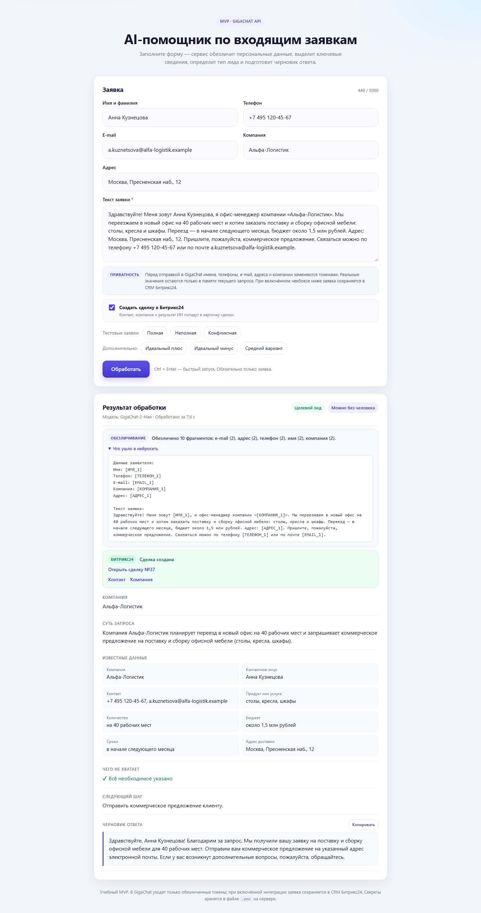

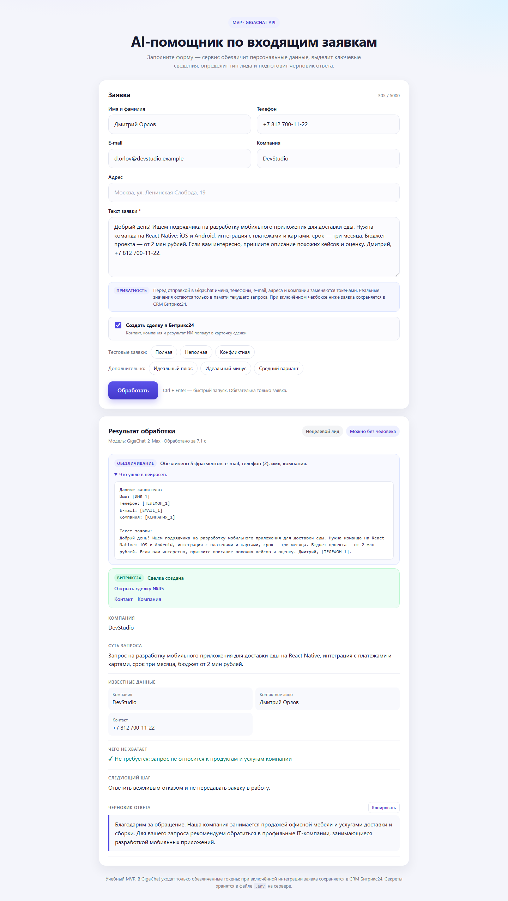

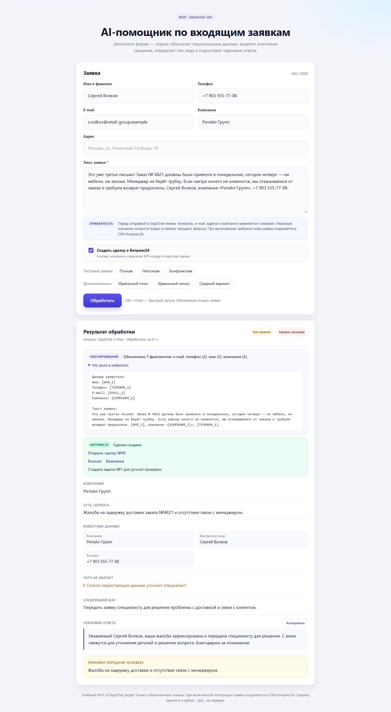

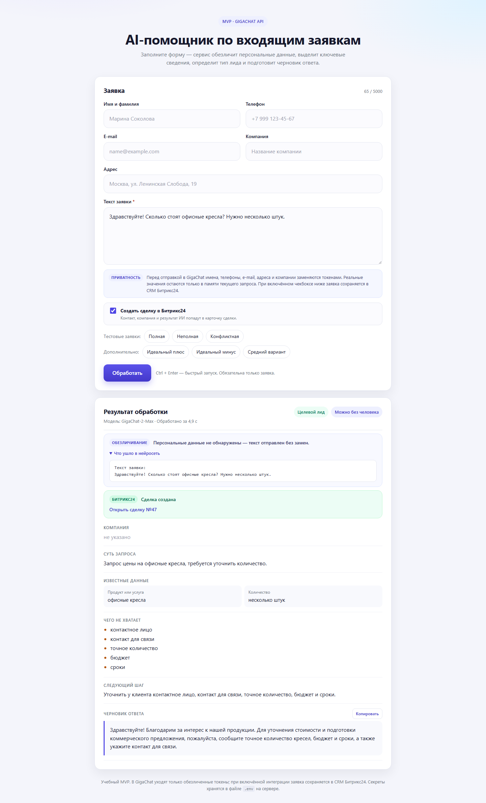

По итогам прогона исправлены четыре расхождения:

- `UF_CRM_AI_NEEDS_HUMAN` не сохранялся: boolean-поле Битрикс24 принимает только `true`/`false`, а не строки `'1'`/`'0'`;
- в черновике ответа после точки оставалась строчная буква — добавлена нормализация регистра;
- нецелевой лид получал выдуманный «отдел по работе с нецелевыми обращениями» — теперь следующий шаг фиксированный;
- при количестве «несколько штук» пункт «точное количество» не всегда попадал в недостающие данные — добавлено правило.

### Улучшения после протокола (26 октября 2026)

1. **Анонимизация реквизитов.** Одиночная фамилия в подписи, ИНН (10 и 12 цифр), ОГРН, КПП и расчётный счёт теперь заменяются токенами. Исправлен тип токена для 10-значного ИНН: раньше он определялся как телефон.
2. **CSV-журнал анонимизации.** Файл `logs/anonymization.csv` хранит только время, `request_id`, модель, счётчики замен по типам, тип лида и статус CRM. Текста заявки и персональных данных в нём нет. Журнал можно скачать из карточки; отключается переменной `PRIVACY_LOG_ENABLED=false`.
3. **Новая карточка результата.** Панель ключевых показателей (тип, решение, пропуски, сделка), цветная полоса по типу лида, пропуски в виде чипсов, копирование всей карточки и отдельно следующего шага, ссылка на CSV-журнал.

Подробное описание, формат журнала и ограничения — в [docs/IMPROVEMENTS.md](docs/IMPROVEMENTS.md), скриншоты — в [`screenshots/improvements`](screenshots/improvements).

| № | Сценарий | Тип лида | Нужен человек | Сделка | Задача | Вердикт |
|---|---|---|---|---|---|---|
| 1 | Целевой лид, 40 мест, 1,5 млн ₽ | Целевой | Нет | №49 | — | ✅ |
| 2 | Разработка мобильного приложения | Нецелевой | Нет | №51 | — | ✅ |
| 3 | Жалоба на задержку доставки | Тип неясен | Да | №53 | №9 | ✅ |
| 4 | «Сколько стоят кресла? Несколько штук» | Целевой | Нет | №55 | — | ✅ |
| 5 | Заявка с ИНН, ОГРН, КПП, р/с и подписью | Целевой | Нет | №57 | — | ✅ |

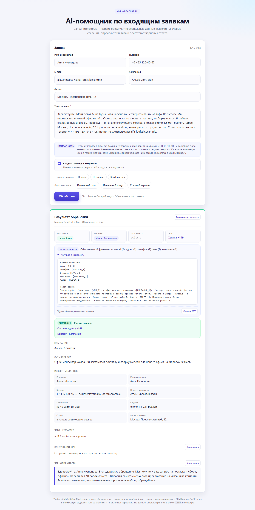

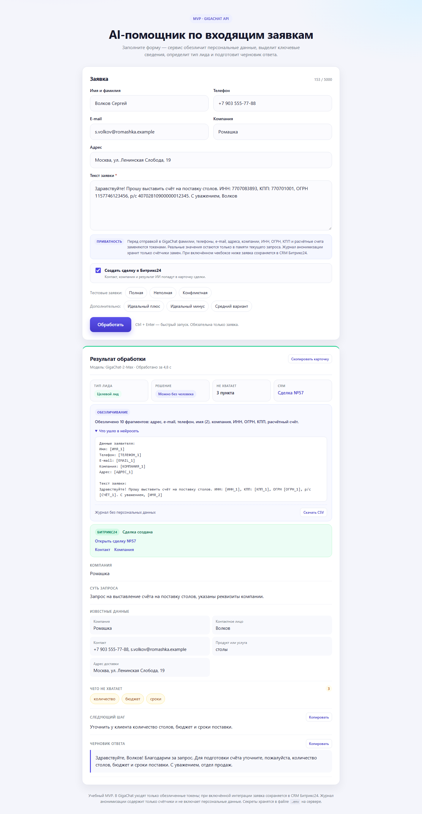

Проверка после улучшений: `npm test` — 36 из 36 на момент прогона, после корректировки промпта — 38 из 38. Журнал после прогона содержит 5 строк и не содержит персональных данных.

#### Скриншоты карточек в Битрикс24

Результаты проверены не только в интерфейсе приложения, но и в самом портале. Для каждого сценария сняты карточка сделки и блок пользовательских полей ИИ:

| № | Сделка | Карточка | Поля ИИ |
|---|---|---|---|
| — | Список сделок | [01-spisok-sdelok.png](screenshots/bitrix24/01-spisok-sdelok.png) | — |
| 1 | №49, целевой | [02-sdelka-49-celevoy.png](screenshots/bitrix24/02-sdelka-49-celevoy.png) | [02-sdelka-49-celevoy-pole.png](screenshots/bitrix24/02-sdelka-49-celevoy-pole.png) |
| 2 | №51, нецелевой | [03-sdelka-51-necelevoy.png](screenshots/bitrix24/03-sdelka-51-necelevoy.png) | [03-sdelka-51-necelevoy-pole.png](screenshots/bitrix24/03-sdelka-51-necelevoy-pole.png) |
| 3 | №53, жалоба | [04-sdelka-53-zhaloba.png](screenshots/bitrix24/04-sdelka-53-zhaloba.png) | [04-sdelka-53-zhaloba-pole.png](screenshots/bitrix24/04-sdelka-53-zhaloba-pole.png) |
| 4 | №55, недостаточно данных | [05-sdelka-55-nedostatochno.png](screenshots/bitrix24/05-sdelka-55-nedostatochno.png) | [05-sdelka-55-nedostatochno-pole.png](screenshots/bitrix24/05-sdelka-55-nedostatochno-pole.png) |
| 5 | №57, реквизиты | [06-sdelka-57-rekvizity.png](screenshots/bitrix24/06-sdelka-57-rekvizity.png) | [06-sdelka-57-rekvizity-pole.png](screenshots/bitrix24/06-sdelka-57-rekvizity-pole.png) |
| 3 | Задача к сделке №53 | [07-zadacha-9.png](screenshots/bitrix24/07-zadacha-9.png) | — |

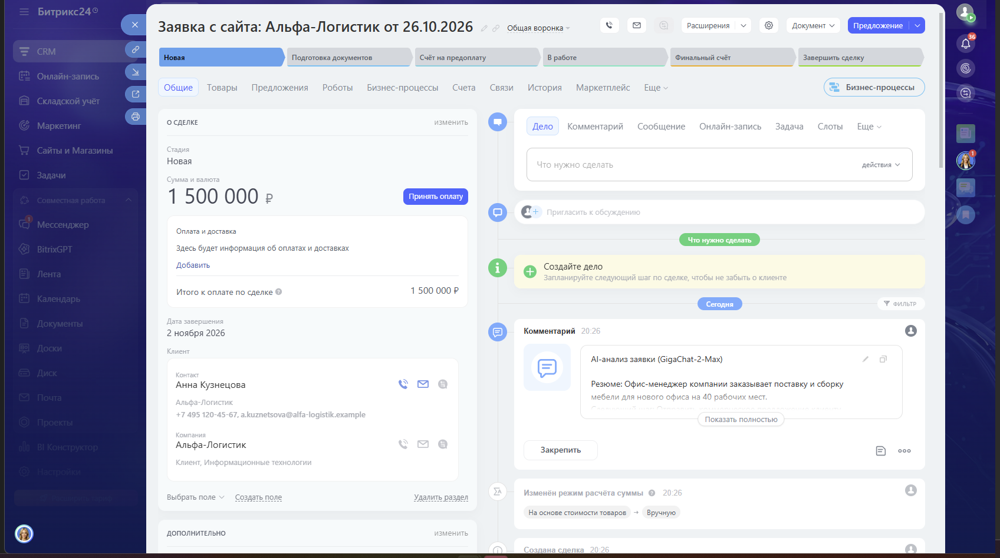

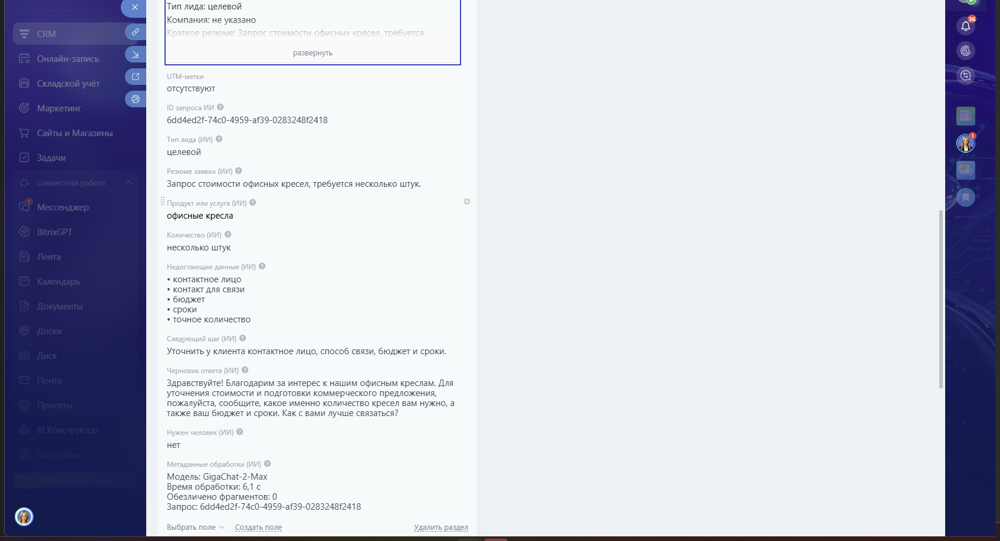

Полный разбор значений, ID сущностей и найденных расхождений — в [docs/TEST_PROTOCOL_IMPROVEMENTS.md](docs/TEST_PROTOCOL_IMPROVEMENTS.md).

#### Корректировка промпта: все пропуски в следующем шаге

Повторный прогон выявил расхождение в сделке №55: в `missing_data` было пять пунктов, включая «точное количество», а `next_step` называл только четыре. Менеджер, который читает только следующий шаг, мог не уточнить количество и не рассчитать стоимость.

Что изменено:

- `prompt.js` требует перечислять в `next_step` **все** пункты `missing_data`, а не только бюджет и сроки;
- в список токенов добавлены `[ИНН_n]`, `[ОГРН_n]`, `[КПП_n]`, `[СЧЁТ_n]`;
- `ensureNextStepClarifications` в `gigachat.js` дописывает пункт, если модель его пропустила.

Исходный ответ сделки №55 после корректировки: «Уточнить у клиента контактное лицо, способ связи, бюджет и сроки, а также точное количество.» Живой повторный запрос с новым промптом назвал все пять пунктов: «Уточнить у клиента точное количество, контактное лицо и контакт для связи, а также бюджет и сроки.»

Текст «до/после», обоснование и границы — в [docs/PROMPT_IMPROVEMENTS.md](docs/PROMPT_IMPROVEMENTS.md). Тестов стало 38: добавлены проверки дописывания пропущенного пункта и сохранения уже полного шага.

### Первичная проверка качества анализа (25 октября 2026)

Проверка выполнена **25 октября 2026 года** на реальном GigaChat API (модель `GigaChat-2-Max`, scope `GIGACHAT_API_PERS`). Каждый сценарий прогнан через интерфейс: кнопка тестовой заявки → «Обработать» → карточка результата. Скриншоты лежат в папке [`screenshots`](screenshots), подробный разбор — в [docs/TEST_REPORT.md](docs/TEST_REPORT.md).

Время обработки и состав `missing_data` могут немного отличаться между запусками: таблицы фиксируют первый прогон, скриншоты — один из повторных.

| № | Сценарий | Тип лида | Нужен человек | Чего не хватает | Время | Вердикт |
|---|---|---|---|---|---|---|
| 1 | Целевой лид | Целевой | Нет | Контактное лицо, контакт для связи | 6,9 с | ⚠️ Частично: данные и тип верны, но система отметила отсутствующие контакты — в таблице ожиданий их не было |
| 2 | Недостаточно данных | Целевой | Нет | Контактное лицо, контакт для связи, точное количество | 5,9 с | ✅ Совпадает |
| 3 | Жалоба | Тип неясен | Да | Компания, контактное лицо, контакт для связи, номер заказа | 5,4 с | ✅ С оговоркой: «неприменимо» показывается как «Тип неясен», потому что схема допускает только три значения |

### Заявка 1 — целевой лид


Компания, продукт, количество, бюджет и сроки извлечены верно, тип — «Целевой», передача человеку не требуется. Дополнительно система отметила, что в тексте нет контактного лица и контакта для связи: это соответствует правилу «не выдумывать данные», хотя в исходной таблице ожиданий недостающих данных не предполагалось.

### Заявка 2 — недостаточно данных


Тип определён как «Целевой» (запрос про кресла с намерением купить), в «Чего не хватает» перечислены контакт, точное количество, в черновике — уточняющие вопросы. Человек не требуется.

### Заявка 3 — жалоба


Жалоба на задержку доставки и угрозу возврата предоплаты передана человеку, причина зафиксирована, черновик ответа нейтральный: без обещаний сроков, возврата и компенсаций. Тип лида показан как «Тип неясен», поскольку жалоба не является новым лидом, а схема допускает только значения «целевой / нецелевой / неясно».

### Дополнительные сценарии

В приложение добавлены ещё три кнопки: «Идеальный плюс», «Идеальный минус» и «Средний вариант».

| № | Сценарий | Тип лида | Нужен человек | Чего не хватает | Время | Вердикт |
|---|---|---|---|---|---|---|
| 4 | Идеальный плюс — все данные | Целевой | Нет | — | 5,4 с | ✅ Все поля заполнены, недостающих данных нет |
| 5 | Идеальный минус — реклама вакансий | Нецелевой | Нет | — (для нецелевого не требуется) | 6,6 с | ✅ Корректный вежливый отказ |
| 6 | Средний вариант — шкафы для раздевалки | Целевой | Нет | Контакты, адрес, бюджет, сроки | 6,5 с | ✅ Уточняющие вопросы в черновике |

#### Идеальный плюс


Компания «Вектор-Медиа», контактное лицо, телефон и e-mail, 25 рабочих мест и 3 шкафа, бюджет 2,3 млн рублей, срок до 15 декабря, адрес доставки — всё извлечено из текста. Тип «Целевой», передача человеку не требуется, «Чего не хватает» — «Всё необходимое указано».

#### Идеальный минус


Предложение разместить вакансии на job-портале корректно определено как нецелевое. Человек не требуется, черновик — вежливый отказ со ссылкой на профиль компании.

#### Средний вариант


Запрос на шкафы для раздевалки распознан как целевой, но для подготовки предложения не хватает контактов, адреса доставки, бюджета и сроков. В черновике — просьба прислать эти данные.

### Что улучшено по итогам тестирования

- жалобы и претензии по существующему заказу теперь квалифицируются как «неясно» и всегда передаются человеку;
- из черновика ответа автоматически убираются неподтверждённые обещания скорости («оперативно», «в кратчайшие сроки», «быстро» и т.п.);
- повторяющиеся «пожалуйста» удаляются;
- английские названия отсутствующих полей (`contact_person`, `contact`) заменяются русскими подписями и дубликаты убираются;
- для целевых лидов бюджет и сроки автоматически попадают в «Чего не хватает», если они не указаны;
- следующий шаг перечисляет все пункты «Чего не хватает», включая точное количество, а не только бюджет и сроки;
- для нецелевого запроса вместо «Всё необходимое указано» показывается «Не требуется: запрос не относится к продуктам и услугам компании»;
- для обращения, переданного человеку, пустой список недостающих данных больше не выглядит как «Всё указано» — карточка сообщает, что его уточнит специалист.

### Корректировки после дополнительной проверки

По итогам ручной проверки найдены и устранены ещё три слабых места:

- черновик теперь обязан спрашивать про бюджет и сроки, если их нет в заявке;
- карточка показывает только заполненные поля, а не восемь строк с «не указано»;
- у нецелевого лида цена и продукт предложения отправителя больше не попадают в «Известные данные» — они остаются только в описании сути запроса.

Тексты корректировок и скриншоты «до/после» — в [docs/CORRECTIONS.md](docs/CORRECTIONS.md), изображения — в [`screenshots/corrections`](screenshots/corrections).

---

## Обезличивание персональных данных

Перед отправкой в GigaChat сервер проходит по заявке отдельным слоем проверки (`privacy.js`):

1. Данные из полей формы заменяются на токены: `[ИМЯ_1]`, `[ТЕЛЕФОН_1]`, `[EMAIL_1]`, `[КОМПАНИЯ_1]`, `[АДРЕС_1]`.
2. Затем текст проверяется регулярными правилами: телефоны в разных форматах, e-mail, ФИО, адреса, компании, паспорт, СНИЛС, ИНН, банковская карта, дата рождения, мессенджеры.
3. Найденные значения заменяются на токены, а исходные значения складываются в `Map` внутри текущего HTTP-запроса.
4. Слой делает повторный проход и проверяет, не осталось ли телефонов, e-mail, документов или карт. Если остались — запрос не отправляется в модель.
5. GigaChat получает только обезличенный текст. После ответа сервер подставляет реальные значения обратно во все поля результата.
6. В `finally` соответствия очищаются. Они не пишутся на диск, не кэшируются между запросами и не попадают в логи.

В карточке результата показывается, сколько фрагментов обезличено, и предпросмотр текста, который ушёл в нейросеть. В предпросмотре видны только токены, без реальных значений.

Проверить слой отдельно можно командой:

```
npm test
```

Тесты не обращаются к GigaChat и проверяют телефоны, e-mail, ФИО, фамилию в подписи, адреса, документы, ИНН/ОГРН/КПП/расчётный счёт, восстановление значений, изоляцию запросов, CSV-журнал без персональных данных и полноту следующего шага. Всего 38 тестов.

---

## Архитектура (C4)

Ниже — три уровня модели C4 и три схемы поведения: последовательность обработки запроса, маршрутизация лида и конвейер обезличивания с журналом. В README вставлены PNG-версии, поэтому схемы не зависят от встроенного Mermaid-рендерера GitHub и одинаково отображаются в браузере. Исходники Mermaid и SVG-версии лежат в папке [`docs/diagrams`](docs/diagrams): [`уровень 1`](docs/diagrams/c4-level-1-context.mmd), [`уровень 2`](docs/diagrams/c4-level-2-containers.mmd), [`уровень 3`](docs/diagrams/c4-level-3-components.mmd), [`последовательность`](docs/diagrams/sequence-analyze.mmd), [`маршрутизация`](docs/diagrams/lead-routing.mmd), [`обезличивание`](docs/diagrams/privacy-pipeline.mmd).

### Уровень 1 — контекст системы

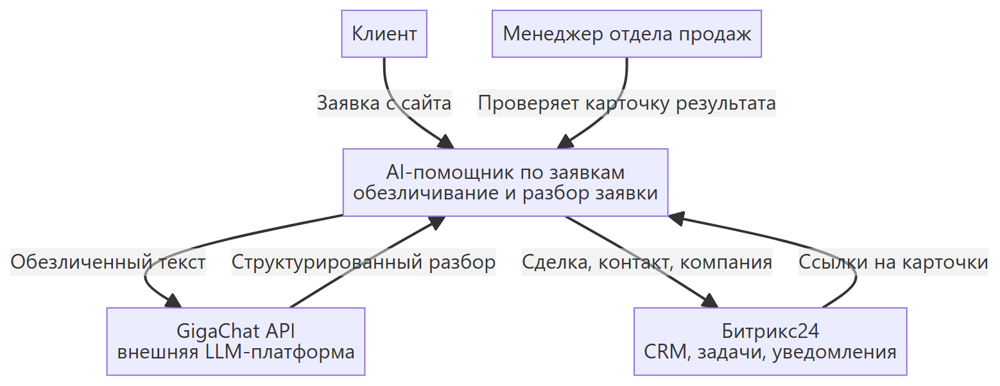

### Уровень 2 — контейнеры

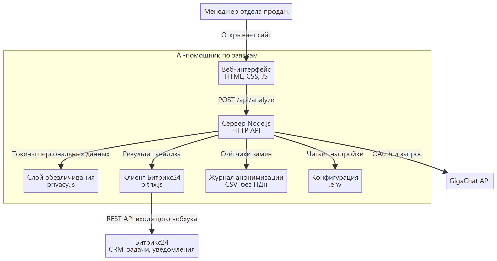

### Уровень 3 — компоненты сервера

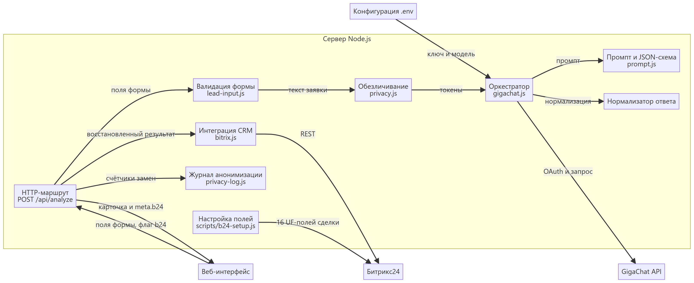

### Последовательность обработки заявки

Схема показывает полный путь запроса: валидация → обезличивание → GigaChat → восстановление данных → сделка, контакт, компания, задача и уведомление. Ветка `else` описывает поведение при ошибке Битрикс24: результат анализа всё равно возвращается пользователю.

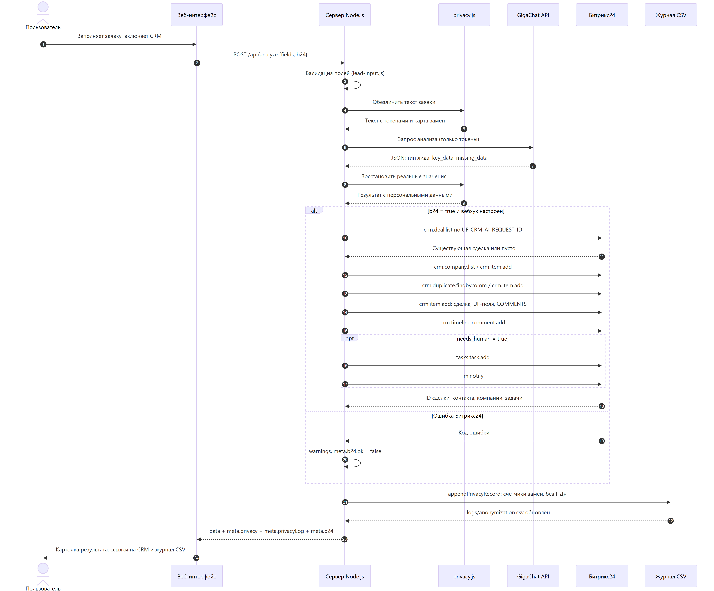

### Маршрутизация лида

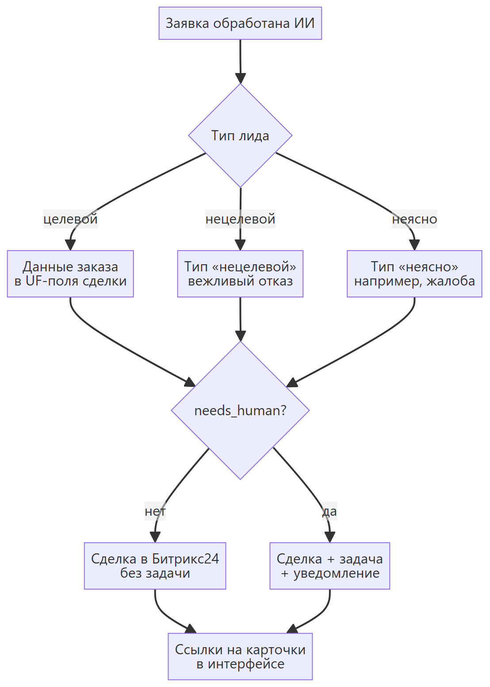

### Обезличивание и журнал

Схема показывает два независимых потока: в GigaChat уходит только текст с токенами, а в локальный CSV-журнал — только счётчики замен. Персональные данные не попадают ни туда, ни туда; реальные значения восстанавливаются уже после ответа модели.

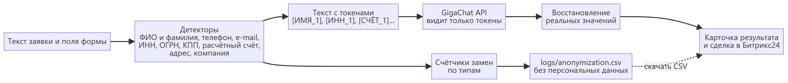

### Поток обработки заявки

1. Страница отправляет данные формы и флаг «Создать сделку в Битрикс24» на сервер (`POST /api/analyze`).
2. Сервер проверяет поля и собирает текст заявки.
3. Слой обезличивания заменяет персональные данные на токены (включая одиночную фамилию, ИНН, ОГРН, КПП и расчётный счёт) и делает контрольный повторный проход.
4. Сервер получает токен доступа GigaChat (действует 30 минут, кэшируется) и отправляет в модель `GigaChat-2-Max` только обезличенный текст.
5. Модель обязана вернуть JSON строго по схеме (`response_format: json_schema`, `strict: true`).
6. Сервер дополнительно проверяет ответ: приводит тип лида к одному из трёх значений, подставляет «не указано» вместо пустых полей, проверяет причину передачи человеку, очищает черновик от обещаний скорости и восстанавливает регистр. При необходимости делает один повторный запрос.
7. Сервер восстанавливает реальные значения вместо токенов и очищает временное соответствие.
8. Если интеграция включена, сервер идемпотентно создаёт компанию, контакт и сделку в Битрикс24, записывает результат ИИ в UF-поля и `COMMENTS`, добавляет комментарий в таймлайн. При `needs_human` создаёт задачу и отправляет уведомление.
9. В `logs/anonymization.csv` добавляется строка со счётчиками замен, типом лида и статусом CRM. Персональных данных в ней нет; ошибка записи не влияет на результат анализа.
10. Страница показывает карточку с панелью показателей, предпросмотр обезличенного текста, ссылки на карточки CRM и кнопку скачивания CSV-журнала.

---

## Если что-то пошло не так

| Сообщение | Что делать |
|---|---|
| «Не настроен доступ к GigaChat» | В файле `.env` не заполнен `GIGACHAT_AUTHORIZATION_KEY`. Вставьте ключ и перезапустите приложение. |
| «GigaChat отклонил ключ авторизации» | Ключ скопирован не полностью или отозван. Получите новый в Studio → Настройки API → Получить ключ. |
| «GigaChat не разрешил доступ с текущим scope» | Поменяйте `GIGACHAT_SCOPE` на `GIGACHAT_API_CORP` (если вы юрлицо/ИП) и перезапустите. |
| «В проекте закончились токены» | Пополните баланс токенов в личном кабинете GigaChat API. |
| «Не удалось проверить защищённый сертификат GigaChat» | См. раздел «Сертификаты Минцифры» ниже. |
| «Порт 3000 уже занят» | Закройте другое приложение или измените `PORT=3001` в `.env` и откройте `http://localhost:3001`. |
| «Не удалось связаться с приложением» | Сервер не запущен или его окно закрыто. Запустите `start.bat` заново. |
| «Журнал анонимизации» не создаётся | Проверьте права на папку `logs` и значение `PRIVACY_LOG_ENABLED` в `.env`. Ошибка журнала не мешает анализу заявки. |
| Долго думает и затем ошибка таймаута | Проверьте интернет и повторите. GigaChat мог быть временно недоступен. |

Технические подробности запросов видны в чёрном окне сервера. Ключи и тексты заявок туда не записываются.

---

## Сертификаты Минцифры

GigaChat API использует сертификаты НУЦ Минцифры. В проекте уже есть папка `certs` с двумя файлами:

- `russian_trusted_root_ca.pem`
- `russian_trusted_sub_ca.pem`

Сервер подключает их автоматически при старте. В логе будет строка:

```
Сертификаты Минцифры: подключены из папки certs
```

Если файлы удалить или переименовать, приложение попробует использовать системные сертификаты. При ошибке проверки сертификата:

1. Скачайте сертификаты с [gosuslugi.ru/crt](https://www.gosuslugi.ru/crt) для Windows.
2. Установите их в хранилище «Доверенные корневые центры сертификации».
3. Перезапустите приложение.

Сертификаты — публичные файлы, секретов в них нет.

---

## Структура проекта

```
OrdersProcPersDataBtrx\
├─ server.js        — веб-сервер и API-маршрут /api/analyze
├─ gigachat.js      — авторизация в GigaChat, запрос к модели, проверка ответа
├─ privacy.js       — обезличивание персональных данных и восстановление значений
├─ privacy-log.js   — CSV-журнал анонимизации без персональных данных
├─ lead-input.js    — проверка полей формы и сборка текста заявки
├─ bitrix.js        — интеграция с Битрикс24: сделка, контакт, компания, задача
├─ prompt.js        — инструкция для модели и схема результата
├─ scripts\
│  └─ b24-setup.js  — проверка вебхука и создание полей сделки
├─ test\
│  ├─ privacy.test.js — тесты обезличивания без обращения к GigaChat
│  ├─ privacy-log.test.js — тесты CSV-журнала и защиты от формул
│  ├─ gigachat.test.js — тесты нормализации ответа и регистра
│  └─ bitrix.test.js  — тесты маппинга и сценария интеграции с Битрикс24
├─ public\
│  ├─ index.html    — страница приложения
│  ├─ styles.css    — оформление
│  └─ app.js        — поведение страницы и тексты тестовых заявок
├─ screenshots\     — скриншоты тестовых сценариев и PDF-копии страниц
│  ├─ corrections\  — скриншоты «до/после» трёх корректировок
│  ├─ protocol\     — скриншоты приёмочного прогона с Битрикс24
│  ├─ improvements\ — скриншоты после улучшений
│  └─ bitrix24\     — карточки сделок, полей ИИ и задачи в Битрикс24
├─ docs\
│  ├─ TEST_PROTOCOL.md — протокол тестирования с Битрикс24 от 26.10.2026
│  ├─ TEST_PROTOCOL_IMPROVEMENTS.md — протокол повторного прогона после улучшений
│  ├─ IMPROVEMENTS.md — улучшения: анонимизация, CSV-журнал, карточка, промпт
│  ├─ PROMPT_IMPROVEMENTS.md — корректировка промпта «до/после» и проверка
│  ├─ TEST_REPORT.md — подробный отчёт о первичном тестировании
│  ├─ CORRECTIONS.md — тексты корректировок и результаты повторной проверки
│  ├─ CorrectionsExamples.md — примеры точечных корректировок
│  ├─ Шаблон протокола тестирования.md — шаблон протокола
│  └─ diagrams\     — диаграммы C4, последовательности, маршрутизации и обезличивания (PNG/SVG/MMD)
├─ logs\            — журнал анонимизации (создаётся автоматически, в git не попадает)
├─ certs\           — сертификаты Минцифры для защищённого соединения
├─ TestOrders.md    — исходная таблица ожидаемых результатов
├─ InitialPrompt_AIOrderProcessor_MVP.md — исходное задание на MVP
├─ .env             — ВАШ ключ (не попадает в git)
├─ .env.example     — шаблон с пустыми значениями
├─ .gitignore
├─ LICENSE          — Apache License 2.0
├─ package.json     — команда запуска, без сторонних зависимостей
├─ start.bat        — запуск двойным кликом
└─ README.md
```

---

## Настройки (файл `.env`)

| Параметр | Назначение | По умолчанию |
|---|---|---|
| `GIGACHAT_AUTHORIZATION_KEY` | Ключ авторизации из Studio | — |
| `GIGACHAT_CLIENT_ID` | Client ID (альтернатива ключу) | — |
| `GIGACHAT_CLIENT_SECRET` | Client Secret (альтернатива ключу) | — |
| `GIGACHAT_SCOPE` | Тип доступа | `GIGACHAT_API_PERS` |
| `GIGACHAT_MODEL` | Модель GigaChat | `GigaChat-2-Max` |
| `PORT` | Порт локального сайта | `3000` |
| `B24_URL` | Ссылка входящего вебхука Битрикс24 | — |
| `B24_ENABLED` | Отправлять заявки в CRM | `true` |
| `B24_RESPONSIBLE_ID` | Ответственный за сделку и задачу | пользователь вебхука |
| `B24_SOURCE_ID` | Источник сделки | `WEB` |
| `B24_CURRENCY` | Валюта сделки | `RUB` |
| `B24_TASK_ON_HUMAN` | Создавать задачу при ручной проверке | `true` |
| `B24_NOTIFY_ON_HUMAN` | Уведомлять ответственного | `true` |
| `B24_TIMELINE` | Комментарий в таймлайне сделки | `true` |
| `B24_TIMEOUT_MS` | Таймаут запроса к Битрикс24, мс | `12000` |

Можно попробовать другие модели: `GigaChat-2-Max` (качество), `GigaChat-2-Pro` (баланс), `GigaChat-2-Lite` (быстрее и дешевле).

После изменения `.env` приложение нужно перезапустить.

---

## Ограничения MVP

На этом этапе сознательно не сделано:

- локальная база данных: на компьютере результаты не сохраняются, при включённой интеграции — только в Битрикс24;
- авторизация пользователей;
- входящие мессенджеры и почтовые интеграции;
- автоматические источники заявок;
- обратная синхронизация изменений из CRM и история обработок.

Сервер доступен только на этом компьютере (`http://localhost:3000`) и не открыт в локальную сеть.

---

## Безопасность

- Ключи хранятся только в `.env` на сервере.
- `.env` указан в `.gitignore`.
- Ключи не попадают в браузер, в логи и в тексты ошибок.
- В логи пишутся только метод, адрес, код ответа и время обработки.
- Персональные данные из формы обрабатываются локальным сервером. В GigaChat API уходит только обезличенный текст с токенами.
- Соответствие «токен → реальное значение» существует только в памяти текущего запроса и очищается после ответа.
- Реальные значения не сохраняются в файлы приложения, не кэшируются между запросами и не выводятся в предпросмотре. При включённом чекбоксе «Создать сделку в Битрикс24» заявка в восстановленном виде сохраняется в CRM компании.
- URL вебхука Битрикс24 хранится только в `.env`, не передаётся в браузер и не попадает в тексты ошибок и логи. В логах остаются только ID созданных сущностей и коды ошибок.
- При компрометации ссылки вебхука пересоздайте его в Битрикс24 и обновите `B24_URL`.
- Обезличивание выполнено детерминированными правилами и эвристиками. Оно покрывает типовые персональные данные, но не гарантирует обнаружение любых данных в свободной форме. Для продуктивной работы с реальными ПДн нужны юридическая проверка, HTTPS и регламент хранения.

---

## Лицензия

Проект распространяется по лицензии **Apache License 2.0**. Полный текст — в файле [LICENSE](LICENSE).
