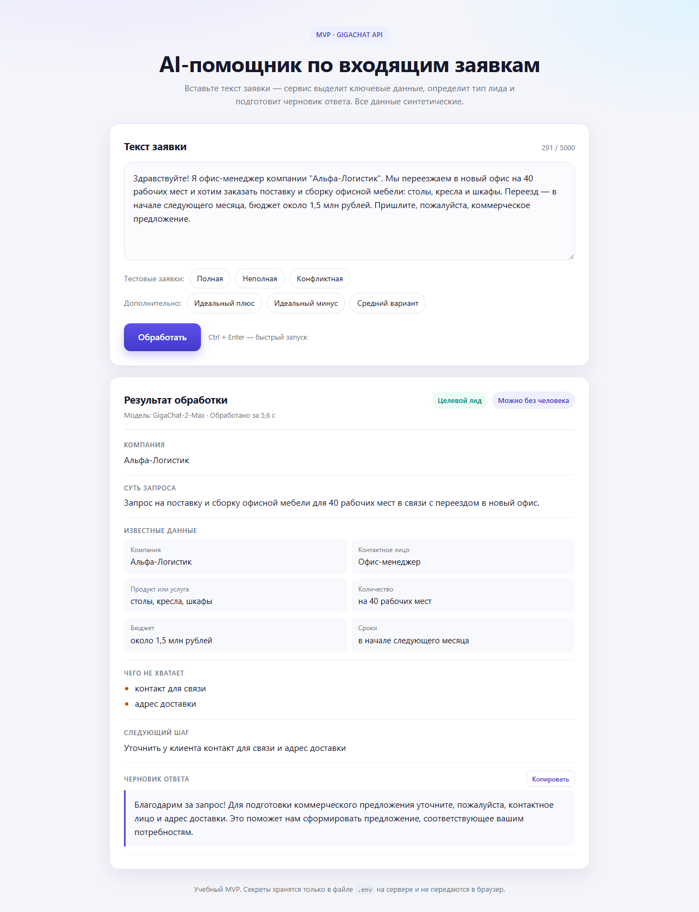
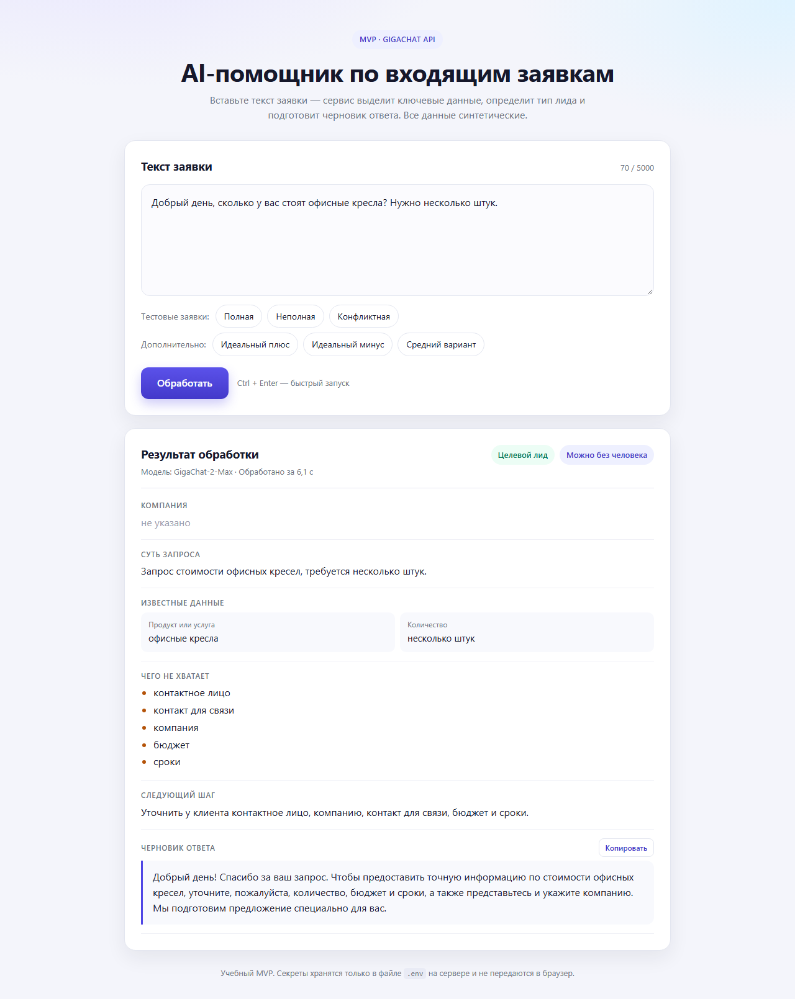
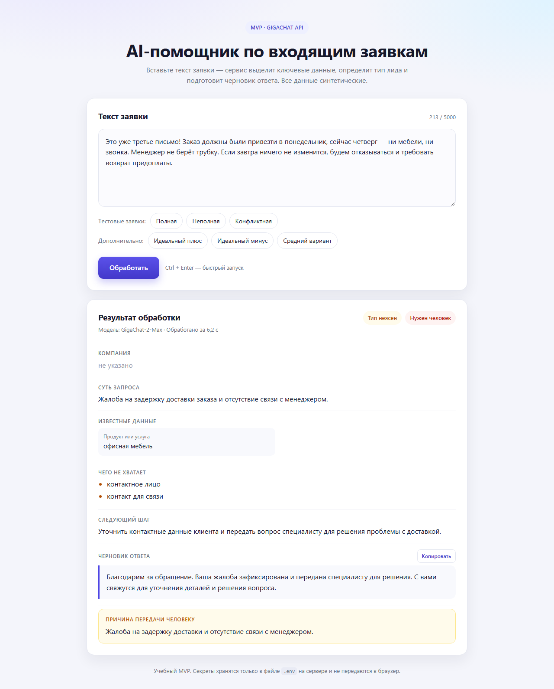
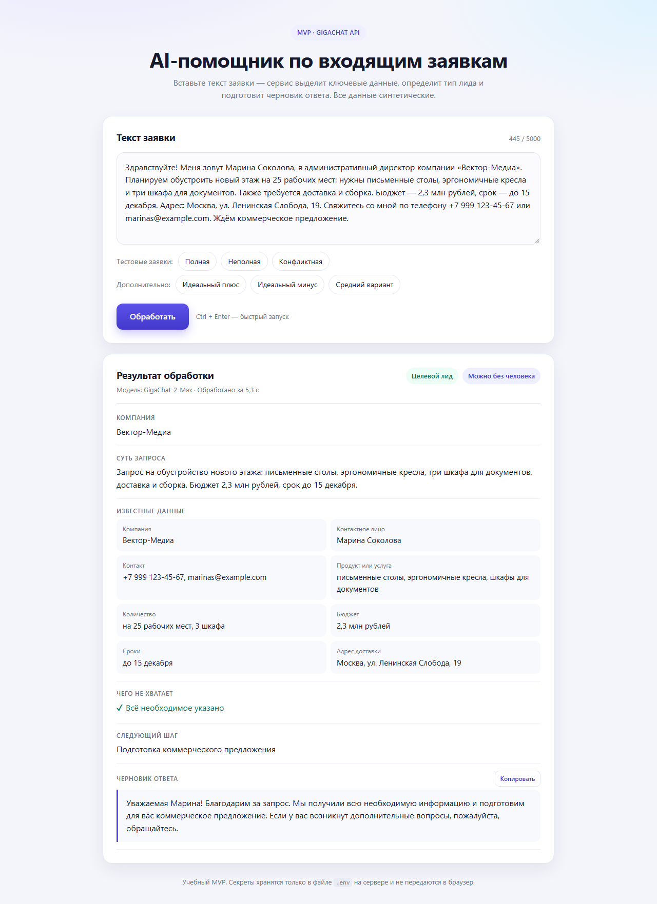
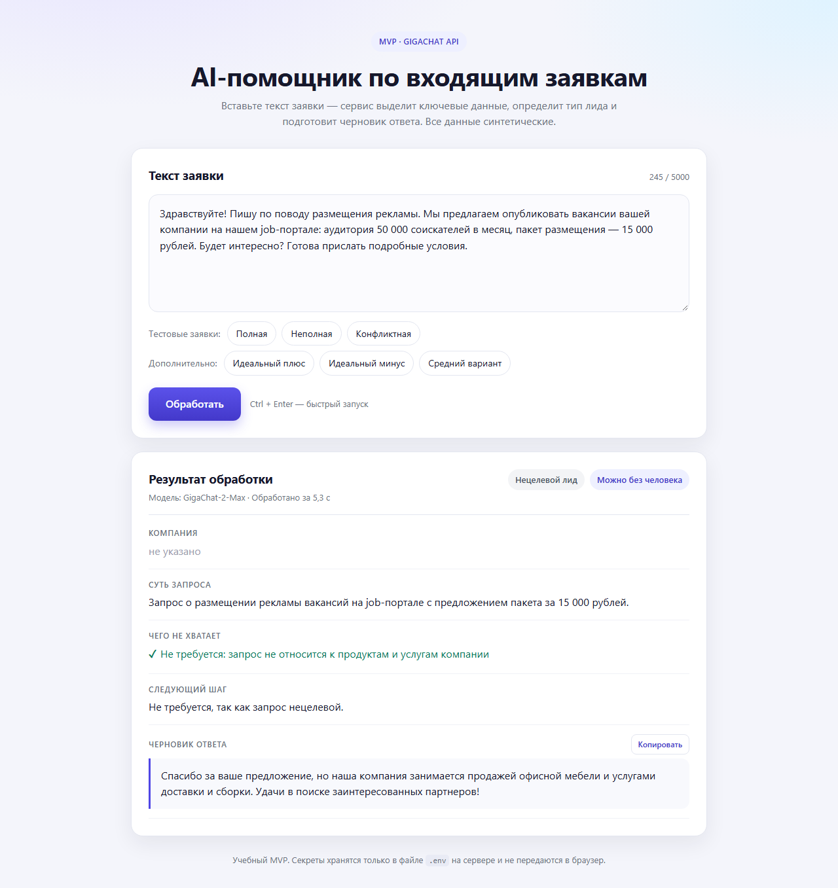
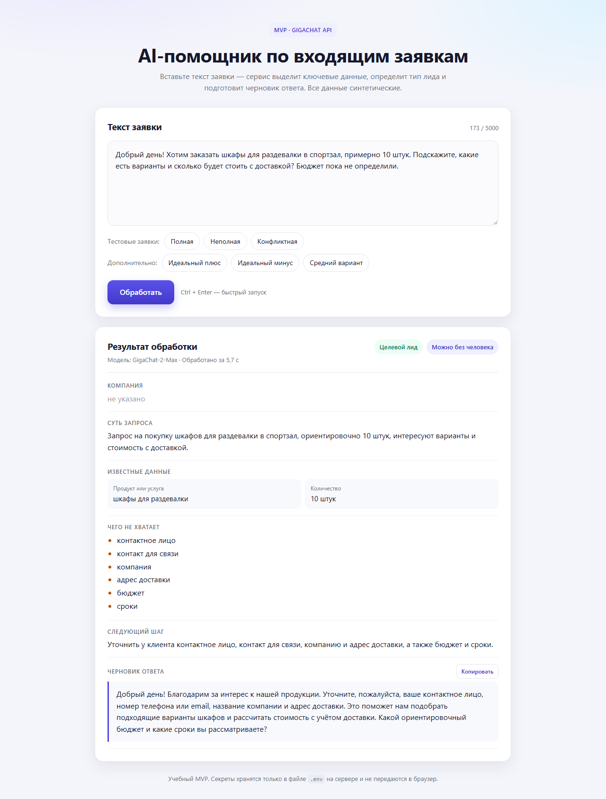
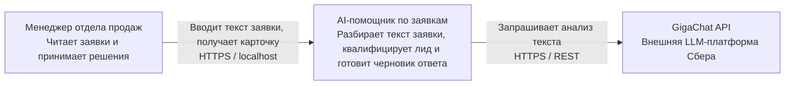
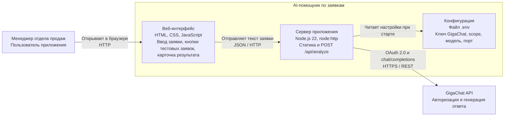
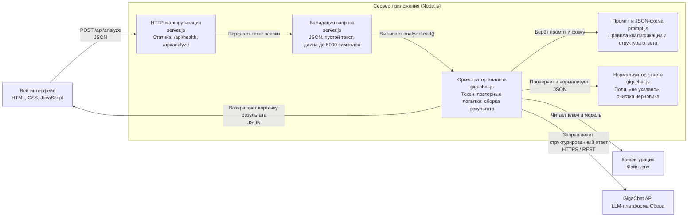

# AI-помощник по входящим заявкам

**Репозиторий:** [github.com/MatveiV/OrdersProcessorAI](https://github.com/MatveiV/OrdersProcessorAI)

AI-помощник по входящим заявкам: вставляете текст заявки — приложение разбирает её с помощью **GigaChat API**, показывает карточку с ключевыми данными, типом лида и черновиком ответа клиенту.

Что умеет:

- выделяет компанию, контакт, продукт, количество, бюджет, сроки и адрес;
- определяет тип лида: **целевой / нецелевой / неясно**;
- показывает, каких данных не хватает, и задаёт 1–2 уточняющих вопроса;
- передаёт человеку жалобы, конфликты, требования возврата и нестандартные запросы;
- формирует нейтральный черновик ответа без неподтверждённых обещаний.

Все данные в проекте синтетические.

## Документация

- [README.md](README.md) — запуск, настройка и проверка приложения.
- [docs/TEST_REPORT.md](docs/TEST_REPORT.md) — отчёт по шести тестовым сценариям.
- [docs/CORRECTIONS.md](docs/CORRECTIONS.md) — три корректировки, скриншоты «до/после» и повторная проверка.
- [docs/CorrectionsExamples.md](docs/CorrectionsExamples.md) — примеры точечных корректировок.
- [TestOrders.md](TestOrders.md) — исходная таблица ожидаемых результатов.

---

## Что понадобится

1. **Node.js 22 LTS или новее** — программа, на которой работает сервер. Скачайте LTS-версию с [nodejs.org](https://nodejs.org/) и установите со стандартными настройками. Проверить версию можно командой `node -v`.
2. **Доступ к GigaChat API** — ключ авторизации из личного кабинета Сбера.
3. Интернет.

Дополнительные библиотеки **не нужны**: проект не использует сторонние пакеты, команда `npm install` не требуется.

### Быстрый старт из GitHub

Склонируйте репозиторий и перейдите в папку проекта:

```
git clone https://github.com/MatveiV/OrdersProcessorAI.git
cd OrdersProcessorAI
```

Если Git не установлен, скачайте архив репозитория через кнопку **Code → Download ZIP** и распакуйте его. Дальше выполните шаги 1–3: получите ключ, заполните `.env` и запустите `start.bat` или `npm start`.

---

## Шаг 1. Получите ключ GigaChat

1. Откройте [личный кабинет Studio](https://developers.sber.ru/studio/) и войдите в аккаунт.
2. Откройте проект **GigaChat API** (если проекта нет — создайте его).
3. В левом меню выберите **Настройки API**.
4. Нажмите **Получить ключ**.
5. Скопируйте значение **Authorization Key** — длинную строку из букв и цифр.

> Ключ показывается только один раз. Сохраните его в надёжном месте.
> Ключ и Client Secret нельзя присылать в чат, публиковать или загружать в git.

### Какой scope выбрать

В файле `.env` есть параметр `GIGACHAT_SCOPE`:

| Кто вы | Значение |
|---|---|
| Физическое лицо | `GIGACHAT_API_PERS` |
| Юридическое лицо или ИП | `GIGACHAT_API_CORP` |
| Юридическое лицо на тарифе B2B | `GIGACHAT_API_B2B` |

Если не уверены — оставьте `GIGACHAT_API_PERS`. Если при запуске появится ошибка доступа, поменяйте значение на `GIGACHAT_API_CORP` и перезапустите приложение.

> С 1 сентября 2026 года новые клиенты GigaChat API оплачивают работу с моделями через платформу cloud.ru. Если у вас новый аккаунт и в проекте нет доступных токенов, сначала подключите оплату — иначе GigaChat вернёт ошибку.

---

## Шаг 2. Вставьте ключ в файл `.env`

1. Откройте папку проекта (например, `C:\GitHub\OrdersProcessorAI` или папку, куда вы клонировали репозиторий).
2. Если файла **`.env`** ещё нет, скопируйте `.env.example` в `.env`. Откройте `.env` Блокнотом: правый клик → **Открыть с помощью** → **Блокнот**.
3. В строке `GIGACHAT_AUTHORIZATION_KEY=` вставьте ключ **сразу после знака равенства**, без пробелов и кавычек:

```
GIGACHAT_AUTHORIZATION_KEY=MDE5...
```

4. Сохраните файл (`Ctrl + S`) и закройте Блокнот.

Файл `.env` уже добавлен в `.gitignore`, поэтому ключ не попадёт в git. В браузер ключ не передаётся: запросы к GigaChat делает только сервер.

Если удобнее хранить `Client ID` и `Client Secret` отдельно — заполните `GIGACHAT_CLIENT_ID` и `GIGACHAT_CLIENT_SECRET`, а строку `GIGACHAT_AUTHORIZATION_KEY` оставьте пустой.

---

## Шаг 3. Запустите приложение

### Способ 1 — двойной клик (проще)

Дважды кликните файл **`start.bat`**.

Откроется чёрное окно с логами и через 2 секунды — браузер со страницей `http://localhost:3000`.

### Способ 2 — через командную строку

Откройте терминал в папке проекта и выполните:

```
npm start
```

Затем откройте в браузере <http://localhost:3000>.

### Как остановить

Вернитесь в чёрное окно и нажмите **Ctrl + C** (или просто закройте окно).

> Чёрное окно закрывать нельзя, пока вы работаете с приложением: это и есть сервер.

---

## Как проверить, что всё работает

На странице есть шесть кнопок с тестовыми заявками: три базовые и три дополнительные.

| Кнопка | Что должно получиться |
|---|---|
| **Полная** | Тип лида «Целевой», заполнены компания «Альфа-Логистик», 40 рабочих мест, бюджет около 1,5 млн рублей, сроки — начало следующего месяца. «Нужен человек» — нет. Система может отметить отсутствие контактного лица и контакта для связи: в тексте их действительно нет. |
| **Неполная** | Тип «Целевой», в «Чего не хватает» перечислены контакт, точное количество и другие данные, в черновике — уточняющие вопросы. |
| **Конфликтная** | Тип «Тип неясен» (квалификация как нового лида неприменима), «Нужен человек» — да, причина связана с жалобой и угрозой возврата, черновик нейтральный, без обещаний. |
| **Идеальный плюс** | Все данные на месте: компания, контакт, продукт, количество, бюджет, сроки, адрес. Тип «Целевой», «Чего не хватает» — «Всё необходимое указано». |
| **Идеальный минус** | Тип «Нецелевой», человек не нужен, черновик — вежливый отказ. |
| **Средний вариант** | Тип «Целевой», в «Чего не хватает» — контакты, адрес, бюджет и сроки, в черновике — уточняющие вопросы. |

Ещё можно проверить:

- нажать **«Обработать»** с пустым полем — появится понятное сообщение;
- убрать ключ из `.env` и перезапустить — приложение подскажет, что доступ не настроен;
- нажать **«Копировать»** под черновиком — текст ответа скопируется в буфер обмена.

Обычно обработка занимает 5–20 секунд.

---

## Результаты тестирования

Проверка выполнена **25 октября 2026 года** на реальном GigaChat API (модель `GigaChat-2-Max`, scope `GIGACHAT_API_PERS`). Каждый сценарий прогнан через интерфейс: кнопка тестовой заявки → «Обработать» → карточка результата. Скриншоты лежат в папке [`screenshots`](screenshots), подробный разбор — в [docs/TEST_REPORT.md](docs/TEST_REPORT.md).

Время обработки и состав `missing_data` могут немного отличаться между запусками: таблицы фиксируют первый прогон, скриншоты — один из повторных.

| № | Сценарий | Тип лида | Нужен человек | Чего не хватает | Время | Вердикт |
|---|---|---|---|---|---|---|
| 1 | Целевой лид | Целевой | Нет | Контактное лицо, контакт для связи | 6,9 с | ⚠️ Частично: данные и тип верны, но система отметила отсутствующие контакты — в таблице ожиданий их не было |
| 2 | Недостаточно данных | Целевой | Нет | Контактное лицо, контакт для связи, точное количество | 5,9 с | ✅ Совпадает |
| 3 | Жалоба | Тип неясен | Да | Компания, контактное лицо, контакт для связи, номер заказа | 5,4 с | ✅ С оговоркой: «неприменимо» показывается как «Тип неясен», потому что схема допускает только три значения |

### Заявка 1 — целевой лид



Компания, продукт, количество, бюджет и сроки извлечены верно, тип — «Целевой», передача человеку не требуется. Дополнительно система отметила, что в тексте нет контактного лица и контакта для связи: это соответствует правилу «не выдумывать данные», хотя в исходной таблице ожиданий недостающих данных не предполагалось.

### Заявка 2 — недостаточно данных



Тип определён как «Целевой» (запрос про кресла с намерением купить), в «Чего не хватает» перечислены контакт, точное количество, в черновике — уточняющие вопросы. Человек не требуется.

### Заявка 3 — жалоба



Жалоба на задержку доставки и угрозу возврата предоплаты передана человеку, причина зафиксирована, черновик ответа нейтральный: без обещаний сроков, возврата и компенсаций. Тип лида показан как «Тип неясен», поскольку жалоба не является новым лидом, а схема допускает только значения «целевой / нецелевой / неясно».

### Дополнительные сценарии

В приложение добавлены ещё три кнопки: «Идеальный плюс», «Идеальный минус» и «Средний вариант».

| № | Сценарий | Тип лида | Нужен человек | Чего не хватает | Время | Вердикт |
|---|---|---|---|---|---|---|
| 4 | Идеальный плюс — все данные | Целевой | Нет | — | 5,4 с | ✅ Все поля заполнены, недостающих данных нет |
| 5 | Идеальный минус — реклама вакансий | Нецелевой | Нет | — (для нецелевого не требуется) | 6,6 с | ✅ Корректный вежливый отказ |
| 6 | Средний вариант — шкафы для раздевалки | Целевой | Нет | Контакты, адрес, бюджет, сроки | 6,5 с | ✅ Уточняющие вопросы в черновике |

#### Идеальный плюс



Компания «Вектор-Медиа», контактное лицо, телефон и e-mail, 25 рабочих мест и 3 шкафа, бюджет 2,3 млн рублей, срок до 15 декабря, адрес доставки — всё извлечено из текста. Тип «Целевой», передача человеку не требуется, «Чего не хватает» — «Всё необходимое указано».

#### Идеальный минус



Предложение разместить вакансии на job-портале корректно определено как нецелевое. Человек не требуется, черновик — вежливый отказ со ссылкой на профиль компании.

#### Средний вариант



Запрос на шкафы для раздевалки распознан как целевой, но для подготовки предложения не хватает контактов, адреса доставки, бюджета и сроков. В черновике — просьба прислать эти данные.

### Что улучшено по итогам тестирования

- жалобы и претензии по существующему заказу теперь квалифицируются как «неясно» и всегда передаются человеку;
- из черновика ответа автоматически убираются неподтверждённые обещания скорости («оперативно», «в кратчайшие сроки», «быстро» и т.п.);
- повторяющиеся «пожалуйста» удаляются;
- английские названия отсутствующих полей (`contact_person`, `contact`) заменяются русскими подписями и дубликаты убираются;
- для целевых лидов бюджет и сроки автоматически попадают в «Чего не хватает», если они не указаны;
- для нецелевого запроса вместо «Всё необходимое указано» показывается «Не требуется: запрос не относится к продуктам и услугам компании»;
- для обращения, переданного человеку, пустой список недостающих данных больше не выглядит как «Всё указано» — карточка сообщает, что его уточнит специалист.

### Корректировки после дополнительной проверки

По итогам ручной проверки найдены и устранены ещё три слабых места:

- черновик теперь обязан спрашивать про бюджет и сроки, если их нет в заявке;
- карточка показывает только заполненные поля, а не восемь строк с «не указано»;
- у нецелевого лида цена и продукт предложения отправителя больше не попадают в «Известные данные» — они остаются только в описании сути запроса.

Тексты корректировок и скриншоты «до/после» — в [docs/CORRECTIONS.md](docs/CORRECTIONS.md), изображения — в [`screenshots/corrections`](screenshots/corrections).

---

## Архитектура (C4)

Ниже — три уровня модели C4. Диаграммы собраны на стандартных Mermaid-флоучартах с группировкой через `subgraph`, поэтому корректно отображаются на GitHub, в VS Code и других просмотрщиках с поддержкой Mermaid.

### Уровень 1 — контекст системы



### Уровень 2 — контейнеры



### Уровень 3 — компоненты сервера



### Поток обработки заявки

1. Страница отправляет текст заявки на сервер (`POST /api/analyze`).
2. Сервер получает токен доступа GigaChat (действует 30 минут, кэшируется) и отправляет запрос в модель `GigaChat-2-Max`.
3. Модель обязана вернуть JSON строго по схеме (`response_format: json_schema`, `strict: true`).
4. Сервер дополнительно проверяет ответ: приводит тип лида к одному из трёх значений, подставляет «не указано» вместо пустых полей, проверяет причину передачи человеку, очищает черновик от обещаний скорости. При необходимости делает один повторный запрос.
5. Страница показывает карточку с русскими подписями.

---

## Если что-то пошло не так

| Сообщение | Что делать |
|---|---|
| «Не настроен доступ к GigaChat» | В файле `.env` не заполнен `GIGACHAT_AUTHORIZATION_KEY`. Вставьте ключ и перезапустите приложение. |
| «GigaChat отклонил ключ авторизации» | Ключ скопирован не полностью или отозван. Получите новый в Studio → Настройки API → Получить ключ. |
| «GigaChat не разрешил доступ с текущим scope» | Поменяйте `GIGACHAT_SCOPE` на `GIGACHAT_API_CORP` (если вы юрлицо/ИП) и перезапустите. |
| «В проекте закончились токены» | Пополните баланс токенов в личном кабинете GigaChat API. |
| «Не удалось проверить защищённый сертификат GigaChat» | См. раздел «Сертификаты Минцифры» ниже. |
| «Порт 3000 уже занят» | Закройте другое приложение или измените `PORT=3001` в `.env` и откройте `http://localhost:3001`. |
| «Не удалось связаться с приложением» | Сервер не запущен или его окно закрыто. Запустите `start.bat` заново. |
| Долго думает и затем ошибка таймаута | Проверьте интернет и повторите. GigaChat мог быть временно недоступен. |

Технические подробности запросов видны в чёрном окне сервера. Ключи и тексты заявок туда не записываются.

---

## Сертификаты Минцифры

GigaChat API использует сертификаты НУЦ Минцифры. В проекте уже есть папка `certs` с двумя файлами:

- `russian_trusted_root_ca.pem`
- `russian_trusted_sub_ca.pem`

Сервер подключает их автоматически при старте. В логе будет строка:

```
Сертификаты Минцифры: подключены из папки certs
```

Если файлы удалить или переименовать, приложение попробует использовать системные сертификаты. При ошибке проверки сертификата:

1. Скачайте сертификаты с [gosuslugi.ru/crt](https://www.gosuslugi.ru/crt) для Windows.
2. Установите их в хранилище «Доверенные корневые центры сертификации».
3. Перезапустите приложение.

Сертификаты — публичные файлы, секретов в них нет.

---

## Структура проекта

```
OrdersProcessorAI\
├─ server.js        — веб-сервер и API-маршрут /api/analyze
├─ gigachat.js      — авторизация в GigaChat, запрос к модели, проверка ответа
├─ prompt.js        — инструкция для модели и схема результата
├─ public\
│  ├─ index.html    — страница приложения
│  ├─ styles.css    — оформление
│  └─ app.js        — поведение страницы и тексты тестовых заявок
├─ screenshots\     — скриншоты шести тестовых сценариев и PDF-копии страниц
│  └─ corrections\  — скриншоты «до/после» трёх корректировок
├─ docs\
│  ├─ TEST_REPORT.md — подробный отчёт о тестировании
│  ├─ CORRECTIONS.md — тексты корректировок и результаты повторной проверки
│  └─ CorrectionsExamples.md — примеры точечных корректировок
├─ certs\           — сертификаты Минцифры для защищённого соединения
├─ TestOrders.md    — исходная таблица ожидаемых результатов
├─ InitialPrompt_AIOrderProcessor_MVP.md — исходное задание на MVP
├─ .env             — ВАШ ключ (не попадает в git)
├─ .env.example     — шаблон с пустыми значениями
├─ .gitignore
├─ LICENSE          — Apache License 2.0
├─ package.json     — команда запуска, без сторонних зависимостей
├─ start.bat        — запуск двойным кликом
└─ README.md
```

---

## Настройки (файл `.env`)

| Параметр | Назначение | По умолчанию |
|---|---|---|
| `GIGACHAT_AUTHORIZATION_KEY` | Ключ авторизации из Studio | — |
| `GIGACHAT_CLIENT_ID` | Client ID (альтернатива ключу) | — |
| `GIGACHAT_CLIENT_SECRET` | Client Secret (альтернатива ключу) | — |
| `GIGACHAT_SCOPE` | Тип доступа | `GIGACHAT_API_PERS` |
| `GIGACHAT_MODEL` | Модель GigaChat | `GigaChat-2-Max` |
| `PORT` | Порт локального сайта | `3000` |

Можно попробовать другие модели: `GigaChat-2-Max` (качество), `GigaChat-2-Pro` (баланс), `GigaChat-2-Lite` (быстрее и дешевле).

После изменения `.env` приложение нужно перезапустить.

---

## Ограничения MVP

На этом этапе сознательно не сделано:

- CRM и базы данных (результаты нигде не сохраняются);
- авторизация пользователей;
- мессенджеры и почтовые интеграции;
- автоматические источники заявок;
- история обработок и экспорт.

Сервер доступен только на этом компьютере (`http://localhost:3000`) и не открыт в локальную сеть.

---

## Безопасность

- Ключи хранятся только в `.env` на сервере.
- `.env` указан в `.gitignore`.
- Ключи не попадают в браузер, в логи и в тексты ошибок.
- В логи пишутся только метод, адрес, код ответа и время обработки.
- Текст заявки передаётся в GigaChat API — это внешний сервис. Не вводите реальные персональные данные: проект учебный, данные должны быть синтетическими.

---

## Лицензия

Проект распространяется по лицензии **Apache License 2.0**. Полный текст — в файле [LICENSE](LICENSE).
