# Протокол повторного прогона после улучшений

- **Дата:** 26 октября 2026 года
- **Основа:** рабочая версия после трёх улучшений из [IMPROVEMENTS.md](IMPROVEMENTS.md)
- **Среда:** локальное приложение `http://localhost:3000`, реальные GigaChat API (`GigaChat-2-Max`) и портал Битрикс24 `https://b24-ox9g80.bitrix24.ru`
- **Данные:** синтетические, персональные данные вымышлены
- **Скриншоты приложения:** [`screenshots/improvements`](../screenshots/improvements)
- **Скриншоты Битрикс24:** [`screenshots/bitrix24`](../screenshots/bitrix24)
- **Проверка:** `npm test` на момент прогона — 36 из 36; после корректировки промпта — 38 из 38

Прогон выполнен через интерфейс приложения с включённым чекбоксом **«Создать сделку в Битрикс24»**. Для каждого сценария проверены карточка результата, запись в CRM, связанные контакт и компания, а для жалобы — задача и уведомление. Значения полей дополнительно сверены через REST API, скриншоты карточек сняты в авторизованном браузере.

## Сводка

| № | Сценарий | Ожидаемый результат | Фактический результат | Расхождение |
|---|---|---|---|---|
| 1 | Целевой лид: офис на 40 мест, 1,5 млн ₽ | Тип «целевой», данные заполнены, `next_step` — КП, человек не нужен, сделка, контакт и компания созданы | Тип «целевой», все 8 полей заполнены, `missing_data` пуст, сделка №49, контакт №19, компания №15 | Нет |
| 2 | Нецелевой: разработка мобильного приложения | Тип «нецелевой», без обещаний, сделка создана | Тип «нецелевой», `key_data` не содержит продукт и бюджет предложения, сделка №51, контакт №21, компания №17 | Нет |
| 3 | Жалоба: сорван срок, угроза возврата | `needs_human = да`, причина «жалоба», нейтральный черновик, задача ответственному | Тип «неясно», `needs_human = 1`, причина заполнена, сделка №53, задача №9, уведомление отправлено | Нет |
| 4 | Недостаточно данных: «Сколько стоят кресла? Нужно несколько штук» | `missing_data` заполнен, 1–2 уточняющих вопроса, без цен и сроков | 5 пунктов в `missing_data`, черновик с вопросами, сделка №55 без контакта и компании | `next_step` не назвал «точное количество» — исправлено в промпте и коде |
| 5 | Анонимизация: имя, телефон, e-mail, реквизиты | В GigaChat уходят только токены, в CRM — реальные данные | 10 токенов, включая `[ИНН_1]`, `[ОГРН_1]`, `[КПП_1]`, `[СЧЁТ_1]`; сделка №57, компания №21 | Контакт №23 переиспользован по телефону и сохранил прежнюю компанию №19 |

## Детали по сценариям

### 1. Целевой лид — сделка №49


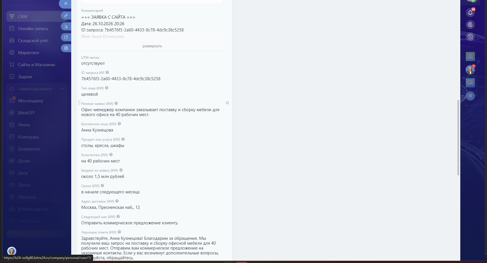

**Заявка.** «Здравствуйте! Меня зовут Анна Кузнецова, я офис-менеджер компании «Альфа-Логистик». Мы переезжаем в новый офис на 40 рабочих мест и хотим заказать поставку и сборку офисной мебели: столы, кресла и шкафы. Переезд — в начале следующего месяца, бюджет около 1,5 млн рублей. Адрес: Москва, Пресненская наб., 12. Пришлите, пожалуйста, коммерческое предложение. Связаться можно по телефону +7 495 120-45-67 или по почте a.kuznetsova@alfa-logistik.example.»

**Результат ИИ.**

| Поле | Значение |
|---|---|
| Тип лида | целевой |
| Компания | Альфа-Логистик |
| Контактное лицо | Анна Кузнецова |
| Контакт | +7 495 120-45-67, a.kuznetsova@alfa-logistik.example |
| Продукт | столы, кресла, шкафы |
| Количество | на 40 рабочих мест |
| Бюджет | около 1,5 млн рублей |
| Сроки | в начале следующего месяца |
| Адрес | Москва, Пресненская наб., 12 |
| Недостающие данные | нет |
| Следующий шаг | Отправить коммерческое предложение клиенту. |
| Нужен человек | нет |

**Битрикс24.**

| Сущность | ID | Что записано |
|---|---|---|
| Сделка | 49 | «Заявка с сайта: Альфа-Логистик от 26.10.2026», стадия `NEW`, сумма 1 500 000 ₽, источник `WEB` |
| Поля ИИ | — | Все `UF_CRM_AI_*` заполнены, `UF_CRM_AI_MISSING` пуст, `UF_CRM_AI_NEEDS_HUMAN = 0` |
| Контакт | 19 | Анна Кузнецова, телефон и e-mail |
| Компания | 15 | Альфа-Логистик |
| Задача | — | Не создавалась: `needs_human = 0` |
| Обезличивание | — | 10 фрагментов заменено, реальные значения восстановлены в карточке и CRM |

### 2. Нецелевой запрос — сделка №51

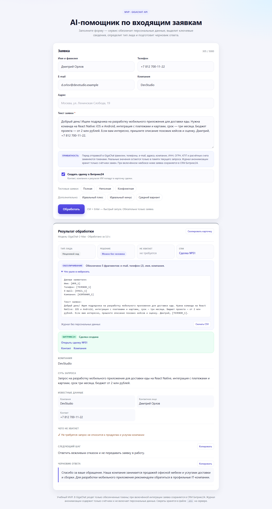

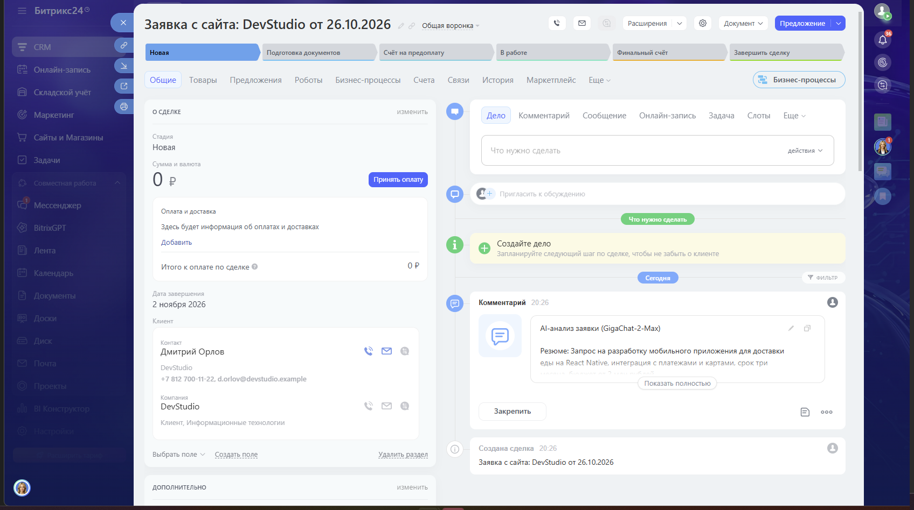

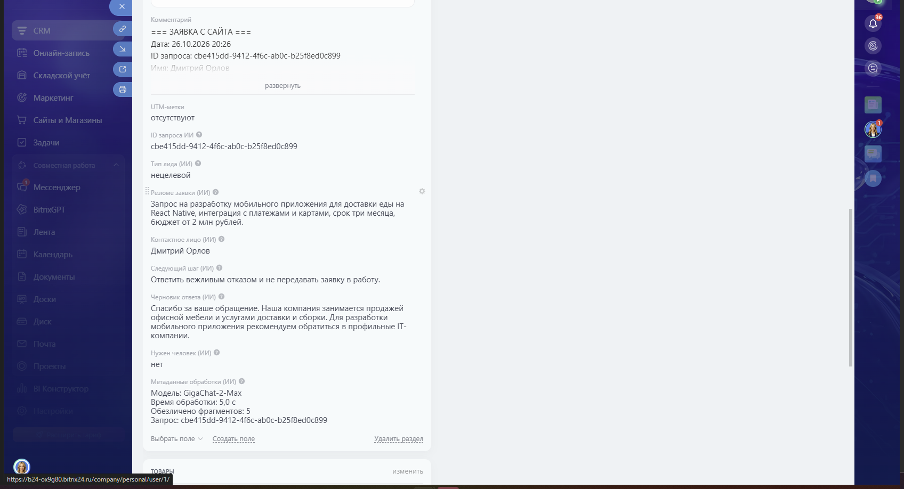

**Заявка.** «Добрый день! Ищем подрядчика на разработку мобильного приложения для доставки еды. Нужна команда на React Native: iOS и Android, интеграция с платежами и картами, срок — три месяца. Бюджет проекта — от 2 млн рублей. Если вам интересно, пришлите описание похожих кейсов и оценку. Дмитрий, +7 812 700-11-22.»

**Результат ИИ.**

| Поле | Значение |
|---|---|
| Тип лида | нецелевой |
| Компания | DevStudio |
| Контактное лицо | Дмитрий Орлов |
| Контакт | +7 812 700-11-22 |
| Продукт, количество, бюджет, сроки, адрес | не указано — условия IT-предложения не переносятся в данные сделки |
| Недостающие данные | нет |
| Следующий шаг | Ответить вежливым отказом и не передавать заявку в работу. |
| Нужен человек | нет |

**Битрикс24.**

| Сущность | ID | Что записано |
|---|---|---|
| Сделка | 51 | «Заявка с сайта: DevStudio от 26.10.2026», сумма 0 ₽, источник `WEB` |
| Поля ИИ | — | `UF_CRM_AI_LEAD_TYPE` = «нецелевой», продукт, количество, бюджет, сроки и адрес пусты |
| Контакт | 21 | Дмитрий Орлов, телефон и e-mail |
| Компания | 17 | DevStudio |
| Задача | — | Не создавалась |
| Обезличивание | — | 5 фрагментов заменено |

### 3. Жалоба — сделка №53, задача №9

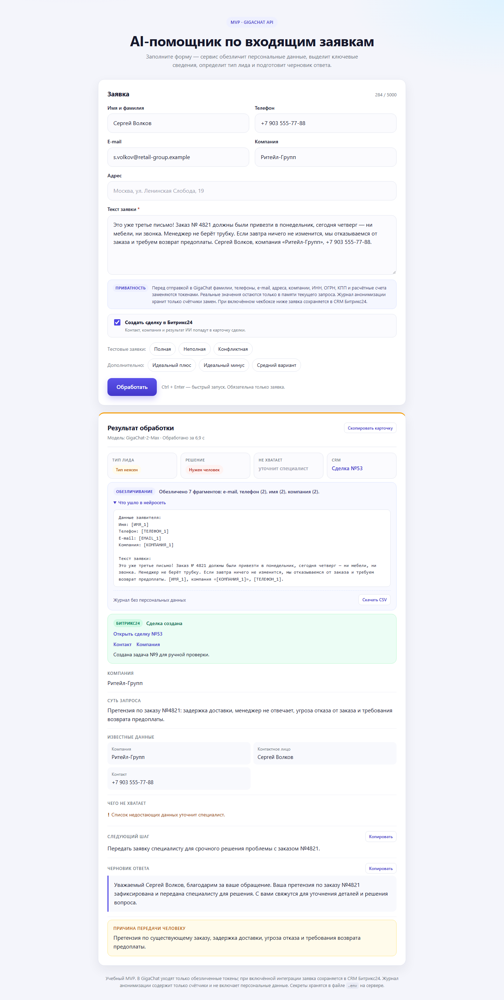

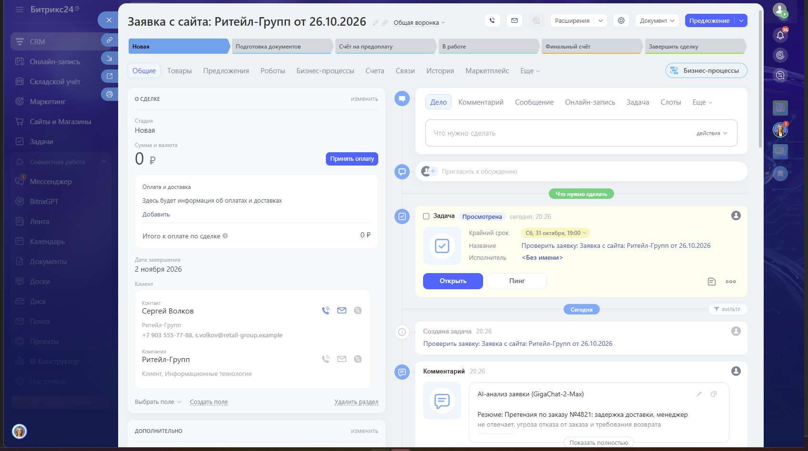

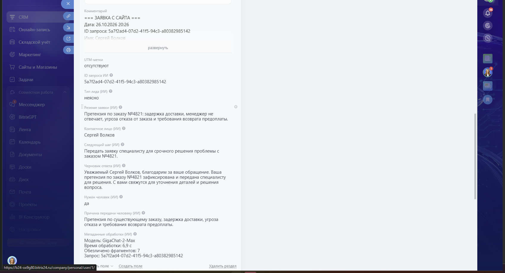

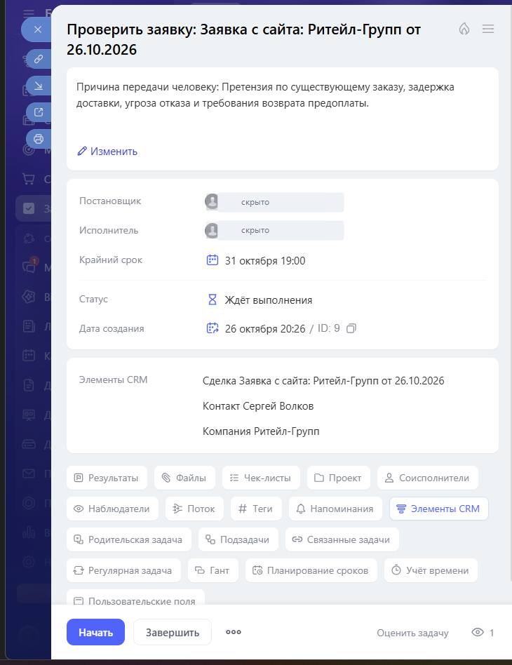

**Заявка.** «Это уже третье письмо! Заказ № 4821 должны были привезти в понедельник, сегодня четверг — ни мебели, ни звонка. Менеджер не берёт трубку. Если завтра ничего не изменится, мы отказываемся от заказа и требуем возврат предоплаты. Сергей Волков, компания «Ритейл-Групп», +7 903 555-77-88.»

**Результат ИИ.**

| Поле | Значение |
|---|---|
| Тип лида | неясно |
| Компания | Ритейл-Групп |
| Контактное лицо | Сергей Волков |
| Контакт | +7 903 555-77-88 |
| Резюме | Претензия по заказу №4821: задержка доставки, менеджер не отвечает, угроза отказа от заказа и требования возврата предоплаты. |
| Следующий шаг | Передать заявку специалисту для срочного решения проблемы с заказом №4821. |
| Нужен человек | да |
| Причина | Претензия по существующему заказу, задержка доставки, угроза отказа и требования возврата предоплаты. |

**Битрикс24.**

| Сущность | ID | Что записано |
|---|---|---|
| Сделка | 53 | «Заявка с сайта: Ритейл-Групп от 26.10.2026», `UF_CRM_AI_NEEDS_HUMAN = 1` |
| Контакт | 23 | Сергей Волков, телефон и e-mail |
| Компания | 19 | Ритейл-Групп |
| Задача | 9 | «Проверить заявку: Заявка с сайта: Ритейл-Групп от 26.10.2026», привязана к `D_53`, срок 31.10.2026 19:00, статус «Ждёт выполнения» |
| Ответственный и постановщик | 1 | Пользователь входящего вебхука |
| Уведомление | — | `im.notify` ответственному |
| Обезличивание | — | 7 фрагментов заменено |

Черновик нейтральный: претензия зафиксирована и передана специалисту, без обещаний возврата, сроков и компенсации.

### 4. Недостаточно данных — сделка №55

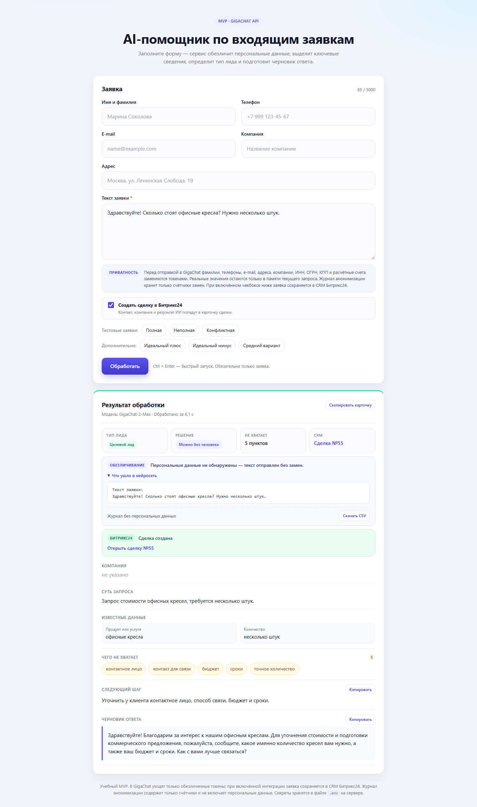

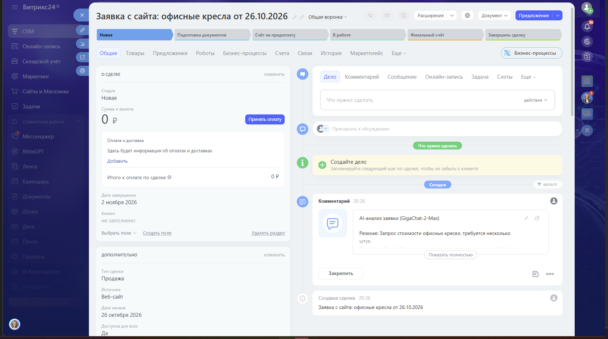


**Заявка.** «Здравствуйте! Сколько стоят офисные кресла? Нужно несколько штук.»

**Результат ИИ.**

| Поле | Значение |
|---|---|
| Тип лида | целевой |
| Компания | не указано |
| Контактное лицо | не указано |
| Контакт | не указано |
| Продукт | офисные кресла |
| Количество | несколько штук |
| Бюджет | не указано |
| Сроки | не указано |
| Адрес | не указано |
| Недостающие данные | контактное лицо; контакт для связи; бюджет; сроки; точное количество |
| Следующий шаг | Уточнить у клиента контактное лицо, способ связи, бюджет и сроки. |
| Нужен человек | нет |

**Битрикс24.**

| Сущность | ID | Что записано |
|---|---|---|
| Сделка | 55 | «Заявка с сайта: офисные кресла от 26.10.2026», сумма 0 ₽ |
| Поля ИИ | — | Продукт и количество заполнены, остальные данные пусты, `UF_CRM_AI_MISSING` содержит 5 пунктов |
| Контакт | — | Не создан: в заявке нет телефона и e-mail |
| Компания | — | Не создана |
| Задача | — | Не создавалась: `needs_human = 0` |
| Обезличивание | — | 0 фрагментов: персональных данных в тексте нет |

**Найденное расхождение.** В `missing_data` есть «точное количество», но `next_step` перечисляет только контактное лицо, способ связи, бюджет и сроки. Менеджер, который читает только следующий шаг, может не уточнить количество и не сможет рассчитать стоимость. Расхождение исправлено на двух уровнях:

1. в `prompt.js` добавлено требование перечислять в `next_step` все пункты `missing_data`;
2. в `gigachat.js` добавлена страховка `ensureNextStepClarifications`: если модель что-то пропустила, пункт дописывается автоматически.

Текст «до/после» и проверка — в [PROMPT_IMPROVEMENTS.md](PROMPT_IMPROVEMENTS.md).

### 5. Анонимизация реквизитов — сделка №57


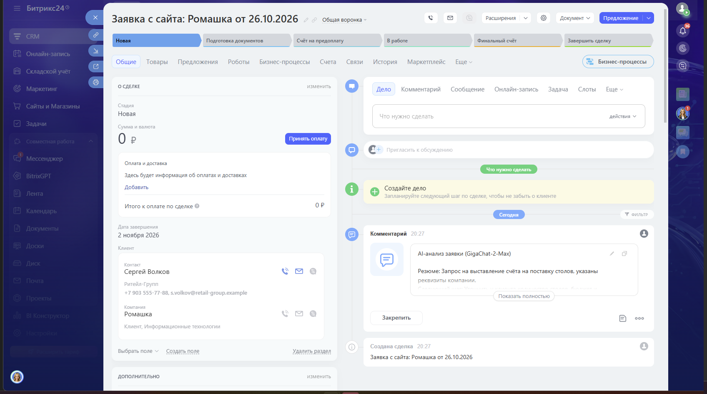

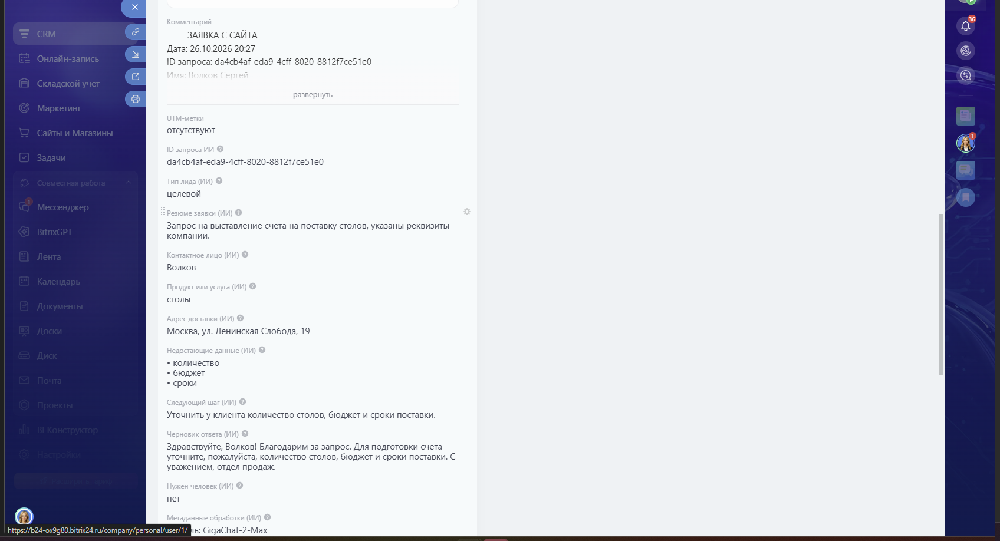

**Заявка.** «Здравствуйте! Прошу выставить счёт на поставку столов. ИНН: 7707083893, КПП: 770701001, ОГРН 1157746123456, р/с 40702810900000012345. С уважением, Волков.»

Дополнительно заполнены поля формы: имя «Волков Сергей», телефон +7 903 555-77-88, e-mail s.volkov@romashka.example, компания «Ромашка», адрес «Москва, ул. Ленинская Слобода, 19».

**Что ушло в GigaChat.**

```text
Здравствуйте! Прошу выставить счёт на поставку столов.
ИНН: [ИНН_1], КПП: [КПП_1], ОГРН [ОГРН_1],
р/с [СЧЁТ_1]. С уважением, [ИМЯ_2]
```

**Результат ИИ.**

| Поле | Значение |
|---|---|
| Тип лида | целевой |
| Компания | Ромашка |
| Контактное лицо | Волков |
| Контакт | +7 903 555-77-88, s.volkov@romashka.example |
| Продукт | столы |
| Адрес | Москва, ул. Ленинская Слобода, 19 |
| Недостающие данные | количество; бюджет; сроки |
| Следующий шаг | Уточнить у клиента количество столов, бюджет и сроки поставки. |
| Нужен человек | нет |

**Битрикс24.**

| Сущность | ID | Что записано |
|---|---|---|
| Сделка | 57 | «Заявка с сайта: Ромашка от 26.10.2026», сумма 0 ₽ |
| Поля ИИ | — | Компания, контактное лицо, продукт и адрес заполнены; количество, бюджет и сроки пусты |
| Контакт | 23 | Переиспользован по совпадению телефона +7 903 555-77-88 |
| Компания | 21 | Ромашка — создана для этой заявки |
| Обезличивание | — | 10 фрагментов заменено, включая ИНН, КПП, ОГРН и расчётный счёт |

**Найденное ограничение.** Контакт №23 был создан в сценарии с жалобой и привязан к компании №19 «Ритейл-Групп»; его e-mail — `s.volkov@retail-group.example`. В новой заявке тот же телефон, но другая компания и другой e-mail. Дедупликация по телефону переиспользовала контакт, однако не изменила его компанию и не добавила новый e-mail, потому что у контакта уже есть e-mail этого типа. В результате сделка №57 привязана к компании №21, а карточка контакта показывает компанию №19.

Это осознанное ограничение текущей модели данных: у контакта в Битрикс24 одна компания, а автоматическая смена компании затронула бы и предыдущие сделки. Варианты решения:

- создавать отдельный контакт, если телефон совпал, а компания отличается;
- хранить компанию только на уровне сделки и не обновлять контакт;
- добавить в контакт несколько e-mail и явно выбирать основной.

В текущей версии выбран безопасный вариант: существующие данные контакта не перезаписываются. Ограничение зафиксировано в [IMPROVEMENTS.md](IMPROVEMENTS.md#ограничения).

## Проверка журнала анонимизации

После пяти сценариев в `logs/anonymization.csv` пять строк. Проверено: в файле нет текста заявок, имён, телефонов, e-mail, адресов, названий компаний и номеров документов — только время, `request_id`, модель, счётчики по типам, тип лида и статус CRM.

## Итоги

- Все пять сценариев дошли до Битрикс24: созданы сделки №49, №51, №53, №55, №57, контакты №19, №21, №23, компании №15, №17, №19, №21 и задача №9.
- Целевой, нецелевой и конфликтный сценарии отработали по ожиданиям.
- Найдено одно расхождение в промпте (`next_step` без «точного количества») — исправлено, покрыто тестами.
- Найдено одно ограничение дедупликации контакта — описано, требует отдельного решения по модели данных.
- Итоговый прогон тестов: 38 из 38.
